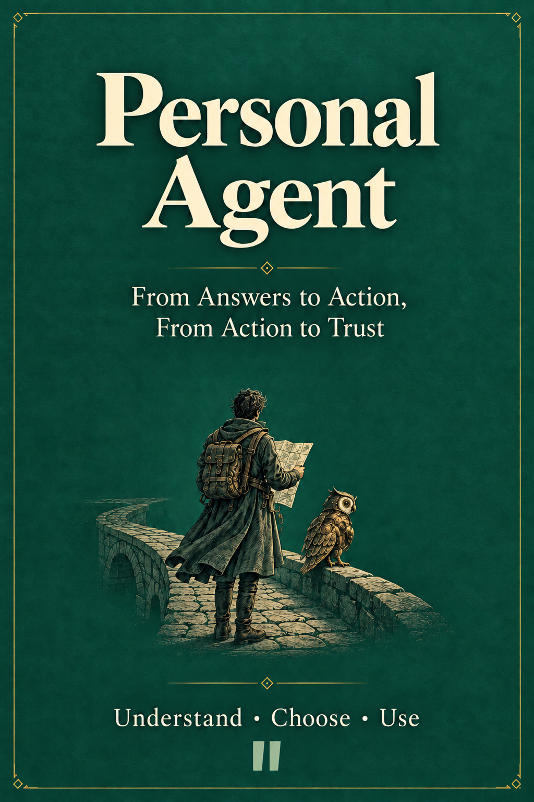

<p align="center">
  
</p>

<h1 align="center">Personal Agent</h1>

<p align="center">
  <strong>从会回答，到能办事，再到值得托付</strong><br>
  理解、选择与使用个人智能体的中文开源书
</p>

<p align="center">
  <a href="https://github.com/mancbj/personal-agent-book/actions/workflows/publish.yml"></a>
  <a href="https://github.com/mancbj/personal-agent-book/releases/latest"></a>
  <a href="LICENSE"></a>
</p>

AI 已经能回答问题、操作工具，甚至在你离开之后继续工作。接下来，你需要判断：**哪些事情值得交给它，怎样交得清楚，以及怎样保留自己的控制权。**

本书从一次航班变更出发，先看今天的产品与能力，再展开选择、使用和授权，简短回望过去，最后讨论可以验证的未来。面向已经接触 AI、希望减少查找、串联、等待和跟进负担的中文读者，阅读无需编程基础。

<p align="center">
  <a href="https://mancbj.github.io/personal-agent-book/"><strong>在线阅读全文</strong></a>
  ·
  <a href="#start-reading"><strong>开始阅读</strong></a>
  ·
  <a href="#downloads"><strong>下载全书</strong></a>
  ·
  <a href="book/appendix-c-worksheets.md"><strong>使用工作表</strong></a>
</p>

<a id="downloads"></a>

## 阅读与下载

当前版本：**[v0.5.0-complete-draft](https://github.com/mancbj/personal-agent-book/releases/tag/v0.5.0-complete-draft)** · 全书初稿审阅版 · 2026-10-10。**四篇正文、12 章、5 个附录已经齐全**，后续继续通读修订与更新产品快照。

<!-- RELEASE-DOWNLOADS-BEGIN -->
| 阅读方式 | 入口 | 适合怎样使用 |
| --- | --- | --- |
| 在线阅读 | [GitHub Pages 全书](https://mancbj.github.io/personal-agent-book/) | 直接开始，使用目录跳转，手机和电脑均可阅读 |
| PDF | [下载阅读版](https://github.com/mancbj/personal-agent-book/releases/download/v0.5.0-complete-draft/personal-agent-book.pdf) | 分页阅读，带封面、目录、书签与矢量图 |
| 单页 HTML | [下载离线版](https://github.com/mancbj/personal-agent-book/releases/download/v0.5.0-complete-draft/personal-agent-book.html) | 一份文件保存全文、封面与图像，断网可读 |
| 完整 Markdown | [下载全书 Markdown](https://github.com/mancbj/personal-agent-book/releases/download/v0.5.0-complete-draft/personal-agent-book.md) | 检索、摘录或用自己的编辑器阅读；图片需随包保存 |
| 全套 ZIP | [下载全部文件](https://github.com/mancbj/personal-agent-book/releases/download/v0.5.0-complete-draft/personal-agent-book-v0.5.0-complete-draft.zip) | 同时获得各格式、分章源稿、封面、图像和来源记录 |
<!-- RELEASE-DOWNLOADS-END -->

[查看全部版本](https://github.com/mancbj/personal-agent-book/releases) · [本版文件校验值](https://github.com/mancbj/personal-agent-book/releases/download/v0.5.0-complete-draft/SHA256SUMS.txt)

<a id="start-reading"></a>

## 从一件你想交出去的事开始

1. 阅读[第一篇说明](book/00-introduction.md)和[第 1 章的行程故事](book/01-what-agents-take-over.md)，看清代理接手的工作。
2. 想理解概念与市场，继续读[第 2 章](book/02-concepts-and-runtimes.md)和[第 3 章](book/03-product-landscape.md)；已有明确任务，可按下方路线跳读。
3. 选择一项低风险任务，复制[附录 C 的选型表与委托单](book/appendix-c-worksheets.md)，记录结果、介入、时间和费用。

## 你会得到什么

- **辨认产品的能力与阶段**：区分回答、执行、持续跟进，也分清曝光、路线宣布、邀请测试和实际可用。
- **选择合适的运行环境**：按资源位置、数据要求、持续在线与维护意愿，比较本地、云端和混合方案。
- **算清代理是否省心**：把配置、监督、审批、纠错与维护都计入试用，用同一项任务比较收益。
- **写出可执行的委托**：说明目标、输入、允许动作、预算、等待条件、验收与异常停点。
- **管理授权与迁移**：知道它能接触什么、如何停止，以及更换服务时哪些状态与权限需要重新确认。
- **判断值得跟踪的未来**：每种情景都有成立前提、观察信号与反证，便于随事实调整判断。

## 本地派与云端派，贯穿全书

**本地部署（Local Runtime）有自己的生态与地位。** OpenClaw、Hermes 靠近本机应用、私有文件、内网、NAS 和硬件；依赖这些资源或严格数据边界的任务，仍有纯云端执行不能直接替代的场景。能否完成，取决于模型、工具、权限和具体配置。

**云端派提供持续在线与托管便利。** Muse、Dot（Dots）等服务帮助用户跨设备联系代理，并由平台承担一部分环境运维。LightVela 云端托管 Hermes、云端调度本地执行等交集，也放在同一张地图上讨论。

代理运行位置、模型推理位置、软件是否开源，分别核对；混合部署继续说明数据流与控制权。相关内容从[第 2 章的概念地图](book/02-concepts-and-runtimes.md)，延伸到[第 5 章的本地场景](book/05-local-runtimes.md)与[第 12 章的数字生活控制权](book/12-control-of-digital-life.md)。

## 按你的目标选择阅读路线

| 你现在想解决什么 | 建议路径 | 可以带走什么 |
| --- | --- | --- |
| 初次认识个人智能体 | [第 1 章](book/01-what-agents-take-over.md) → [第 2 章](book/02-concepts-and-runtimes.md) → [第 3 章](book/03-product-landscape.md) | 分工、概念与产品地图 |
| 选一个方案并交出任务 | [第 4 章](book/04-cloud-agents.md) → [第 5 章](book/05-local-runtimes.md) → [第 7 章](book/07-choosing-an-agent.md) → [第 8 章](book/08-delegating-work.md) → [第 9 章](book/09-trust-and-permissions.md) | 选型依据、试用方法与授权边界 |
| 使用本地资源或自托管 | [第 5 章](book/05-local-runtimes.md) → [第 6 章](book/06-how-agents-work.md) → [附录 D](book/appendix-d-self-hosting.md) | 部署选择、工作循环与起步验收 |
| 理解长期趋势与控制权 | [第 10 章](book/10-history-of-personal-agents.md) → [第 11 章](book/11-future-scenarios.md) → [第 12 章](book/12-control-of-digital-life.md) | 历史口径、验证信号与选择权 |

<details>
<summary><strong>展开全书结构与分章 Markdown</strong></summary>

| 部分 | 阅读入口与章节 |
| --- | --- |
| 第一篇 · 先看今天 | [阅读说明](book/00-introduction.md) · [1·接手什么](book/01-what-agents-take-over.md) · [2·概念与运行环境](book/02-concepts-and-runtimes.md) · [3·产品版图](book/03-product-landscape.md) |
| 第二篇 · 再看细节 | [阅读说明](book/part2-introduction.md) · [4·云端派](book/04-cloud-agents.md) · [5·本地派](book/05-local-runtimes.md) · [6·工作循环](book/06-how-agents-work.md) · [7·选购](book/07-choosing-an-agent.md) · [8·使用](book/08-delegating-work.md) · [9·托付](book/09-trust-and-permissions.md) |
| 第三篇 · 简短回望 | [阅读说明](book/part3-introduction.md) · [10·演进历程](book/10-history-of-personal-agents.md) |
| 第四篇 · 最后看未来 | [阅读说明](book/part4-introduction.md) · [11·未来情景](book/11-future-scenarios.md) · [12·数字生活控制权](book/12-control-of-digital-life.md) |
| 五个附录 | [A·术语](book/appendix-a-glossary.md) · [B·产品快照](book/appendix-b-product-snapshot.md) · [C·工作表](book/appendix-c-worksheets.md) · [D·自托管](book/appendix-d-self-hosting.md) · [E·来源与争议](book/appendix-e-sources-and-disputes.md) |

[完整目录与各章问题](TOC.md) · [版本、出版范围与章节顺序](book.json)

</details>

## 随书的图与工作表

九张原创信息图帮助你看清概念、资源、工作循环、授权与未来。六套可复制工作表覆盖**选型、一周试用、任务委托、长期权限、暂停与迁移、异常与勘误**。另有四个教学案例，帮助把委托落到具体结果。

[浏览信息图](assets/figures/) · [复制工作表](book/appendix-c-worksheets.md) · [阅读委托案例](book/08-delegating-work.md)

<details>
<summary><strong>展开九张信息图索引</strong></summary>

| 位置 | 信息图 |
| --- | --- |
| 第 1 章 | [任务交接](assets/figures/01-handoff.svg) |
| 第 2 章 | [概念与部署地图](assets/figures/02-concept-map.svg) |
| 第 3 章 | [产品版图](assets/figures/03-product-landscape.svg) |
| 第 5 章 | [本地、云端与混合的资源边界](assets/figures/05-resource-boundaries.svg) |
| 第 6 章 | [代理工作循环](assets/figures/06-agent-cycle.svg) |
| 第 7 章 | [选型路径](assets/figures/07-selection-path.svg) |
| 第 9 章 | [授权层次](assets/figures/09-permission-layers.svg) |
| 第 10 章 | [演进历程](assets/figures/10-evolution.svg) |
| 第 11 章 | [未来情景与验证信号](assets/figures/11-future-signals.svg) |

HTML 内嵌图像，PDF 使用矢量图，原始 SVG 与封面随全套 ZIP 提供。

</details>

## 产品、来源与更新

代表产品覆盖 Meta **Muse**、xAI **Grok Bot**、OpenAI **Dot（Dots）**、Manus **Cue**、腾讯 **LightVela**、字节 **Spell**、阿里**千问的 Personal Agent**、**Instinct**、Today AI 的 **Today**，以及 **OpenClaw、Hermes**。

产品资料观察截至 **2026-10-10**，以公开公告和文档为主，尚无统一实机测评。开放阶段、地区、平台、费用口径及未核实项集中在[附录 B](book/appendix-b-product-snapshot.md)。例如 Instinct 的约 10% 日增长保留为访谈自报线索，指标、基数和区间尚未独立核实。

我们保留观点分歧，分析各自成立的条件；事实冲突则回到出处核对。厂商描述、媒体报道、用户体验、作者分析与教学示例分别标明。价格与可用范围以你尝试时的最新官方信息为准。

<details>
<summary><strong>展开编辑依据与核查记录</strong></summary>

初始素材包括三份 AI 深度研究报告与一份博主分类、选购观点摘要，作为研究线索使用。重复说法不能代替独立证据；事实、承诺和情景的采用范围均保留在记录中。

- [素材分歧与编写约定](research/README.md)
- [第一篇：当下产品与概念](research/part1-sources.md)
- [第二篇：部署、实践与权限](research/part2-sources.md)
- [第三篇：历史节点与口径](research/part3-sources.md)
- [第四篇：未来情景与控制权](research/part4-sources.md)
- [附录：产品与安装资料](research/appendices-sources.md)
- [全书来源、争议与更正索引](book/appendix-e-sources-and-disputes.md)

历史发布保留当时快照，在线版随 `main` 更新。更正记录区分原说法有误与产品后续变化。

</details>

## 参与这本书

欢迎通过 [Issues](https://github.com/mancbj/personal-agent-book/issues) 或 Pull Request 提交勘误、阅读反馈、可靠来源、任务体验与图表改进。

- **内容勘误**：给出章节、原句、建议修改和可核对来源。
- **任务体验**：记录日期、版本、套餐、地区、任务条件与结果，可使用[异常记录表](book/appendix-c-worksheets.md)。
- **直接修改**：正文改 `book/`，图改 `assets/figures/`；提交前完成构建检查。较大结构调整先在 Issue 中说明。

正文以中文为主，必要术语首次出现时附英文。引用靠近所支持的结论，保留观察日期与证据边界。请勿提交密钥、凭证或未经许可的私人资料。

如果这本书对你有帮助，欢迎 [Star 并关注更新](https://github.com/mancbj/personal-agent-book)。

<details>
<summary><strong>维护者：仓库结构、本地构建与发布</strong></summary>

章节 Markdown 是正文源稿，各格式由同一份清单生成。版本和章节顺序以 [`book.json`](book.json) 为准。

```text
README.md                 阅读、下载与贡献入口
TOC.md                    全书目录与各章问题
book.json                 版本、出版范围与章节顺序
book/                     章节与附录 Markdown
assets/                   封面、SVG 信息图、HTML 样式与 PDF 排版
research/                 来源、分歧与核查记录
scripts/                  构建与成品检查
.github/workflows/        版本发布和 Pages 部署
dist/                     自动生成的成品，默认不提交
```

构建需要 Python 3.11+、Pandoc 3+、XeLaTeX、Noto CJK 字体、Poppler 和 Cairo。Ubuntu/Debian 可按以下顺序操作：

```bash
git clone https://github.com/mancbj/personal-agent-book.git
cd personal-agent-book
sudo apt-get update
sudo apt-get install -y pandoc texlive-xetex texlive-latex-extra fonts-noto-cjk poppler-utils libcairo2
python3 -m venv .venv
. .venv/bin/activate
python -m pip install -r requirements.txt
python scripts/build.py
python scripts/check.py
```

`dist/` 提供 `index.html`、离线 HTML、PDF、完整 Markdown、全套 ZIP 与 `SHA256SUMS.txt`。检查覆盖章节、链接、内嵌封面与图像、PDF 字体和正文、ZIP 来源记录及文件校验值。

提交到 `main` 会运行构建、检查和 Pages 部署；Pull Request 运行构建检查；推送与 `book.json` 对应的 `v*` 标签会发布全套文件。Pages 部署后，还会验证公开首页和四项下载的 HTTP 状态与 SHA256。[查看出版工作流](.github/workflows/publish.yml) · [查看运行结果](https://github.com/mancbj/personal-agent-book/actions/workflows/publish.yml)

本仓库已启用 GitHub Actions Pages。复用到其他仓库时，管理员需先在 Settings → Pages 选择 GitHub Actions 作为发布来源。

</details>

## 许可与延伸阅读

本项目采用 [Apache License 2.0](LICENSE)，覆盖原创正文、图表与代码。使用、修改和分发时请遵守许可证并保留必要声明。第三方资料、商标及引用内容的权利归原权利人；输入附件未被整篇重新授权。

同一作者的另一本开源书：[《深入理解 AI-DLC》](https://github.com/mancbj/aidlc-book-baojun)，面向研发团队，讨论从人的判断到可验证软件交付的方法。本 README 的阅读导航与信息组织参考了该项目。
