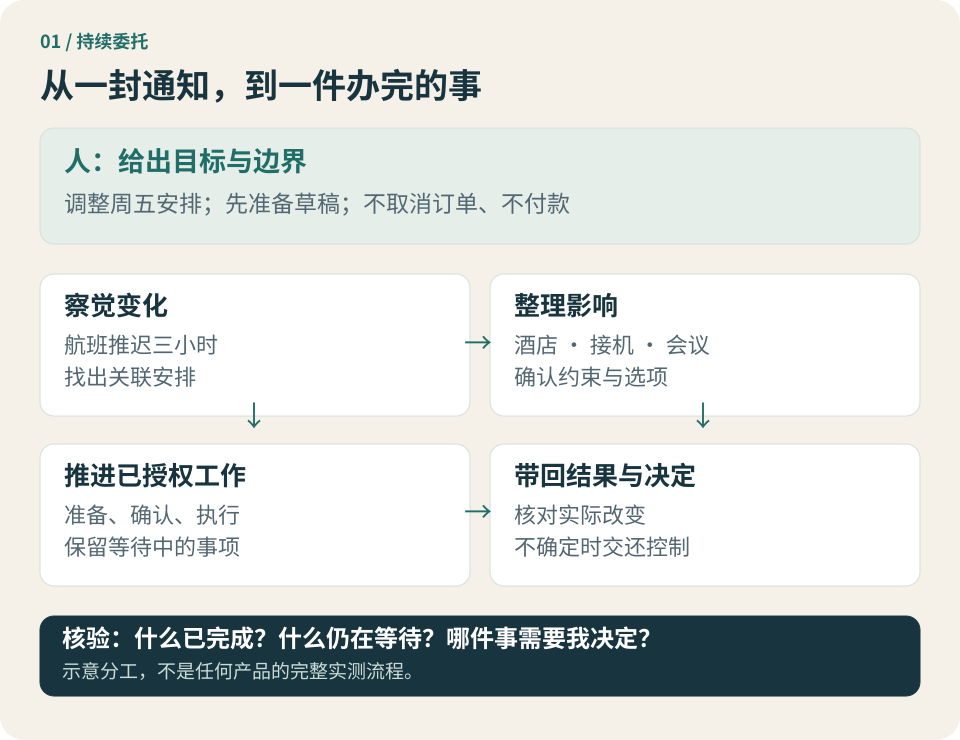

# 第 1 章 · 从一次行程变更，看懂个人智能体

*图 1-1 · 从一封通知到一件办完的事。本图是工作分工示意，不代表任何产品已能完整执行全部步骤。*

**这一章先回答：它与我已经用过的 AI，究竟有什么不同？**

## 麻烦常常发生在步骤之间

星期一傍晚，林岚收到一封邮件：周五的航班推迟了三个小时。

她原本订好了酒店，请朋友接机，还约了落地后的线上会议。航空公司的通知只说明一件事，却改变了四处安排。她得查酒店能否晚到，告诉朋友新的时间，判断会议是否冲突，再记住哪些人还没有回复。

其中没有哪一步特别难。真正费心的是：这些步骤彼此有关，却不会自己连接起来。

酒店的邮件回复，也许要到明天才来。朋友可能回一句“那我改成八点出门”，但航班之后还会变化。会议发起人同意改期后，日历是否更新？新时间是否撞上另一个承诺？如果她只完成前半段，事情还没有结束。

很多人的工作日都充满这种小任务。资料更新后要重做一份表；客户改了需求，要同步方案和日程；家人的预约变更，要通知另一个照顾者。负担来自查找、串联、等待和跟进，也来自不断记住“下一步还没有做”。

个人智能体想进入的，就是这片地方。

## 同一件事，三种分工

第一种方式，是林岚自己完成全部步骤。软件给她搜索、邮件、日历和订单入口，她负责判断它们之间的关系，也负责推动下一步。

第二种方式，是让 AI 给建议。她把航班通知贴进聊天框，AI 列出注意事项，写好给酒店和朋友的消息。她省下了阅读和起草的时间，但仍要打开不同应用、发送消息、等待回复，并告诉 AI 后来发生了什么。

第三种方式，是委托一个能够持续工作的代理。她说明：“请根据新的落地时间检查周五安排。先联系酒店确认晚到，给朋友和会议发起人准备消息；不要取消订单，不要付款，对外发送前让我看。”

如果系统具备相应连接和权限，它就可以读取相关安排、整理影响、形成具体草稿。林岚确认以后，它执行获准动作，保存未完成项，在收到回复时接着处理，并把真正需要她判断的问题带回来。

三种方式都可能有用，区别在于谁承担步骤之间的连接工作。

| 分工方式 | AI 或软件主要交付什么 | 人仍需承担什么 |
| --- | --- | --- |
| 自己操作 | 功能入口与信息 | 查找、判断、执行、等待和跟进 |
| AI 提建议 | 解释、方案与草稿 | 把方案放进真实系统，传递后续状态 |
| 持续委托代理 | 授权范围内的执行结果与任务状态 | 设定目标和边界，作重要取舍，验收结果 |

因此，你不一定需要一个代理。只想把消息写得更清楚，第二种方式已经足够。只有当跨工具、跨时间的交接成为负担时，持续委托才可能带来额外价值。

## 本书怎样理解 Personal Agent

“Personal Agent”不是本书发现的一套统一行业标准。不同公司用它指代的产品，并不完全一样。为了让比较有共同尺度，我们采用一个工作定义：

> 个人智能体是面向具体个人、能保留必要上下文和任务状态，并在可管理的授权范围内，跨工具、跨时间推进事务的 AI 系统。

这个定义包含五项判断。

**第一，它知道这是谁的事情。** 林岚的预算、行程、联系对象和工作习惯，需要与任务相关，而不是只生成一份适用于所有人的旅行建议。这里的“知道”来自用户提供或获准访问的资料，不意味着系统可以自由收集她的一切。

**第二，它能够行动。** 读懂“酒店需要确认”，与真正找到订单、准备消息、执行获准发送，是不同能力。没有合适工具和权限时，代理也只能停在建议阶段。

**第三，事情可以跨越一次会话。** 林岚关掉聊天窗口，不应等于忘掉“还在等酒店回复”。这种持续性需要保存状态，也需要运行中的服务和触发条件；它不会凭空产生。

**第四，行动边界可以管理。** 她可以允许查询，允许准备草稿，却保留取消订单和支付的决定权。“帮我处理”并不等于一张无限授权书。

**第五，结果能够核对。** 代理说“安排好了”时，应能指出什么已经改变、依据是什么、哪些部分仍未完成。一个漂亮总结不能替代订单、日历和对方的实际回复。

这五项是本书的观察尺度。一个产品满足其中某些条件，并不自动在其他条件上成熟。

## 已经出现的产品信号

这种分工已经进入公开产品设计。Meta 的 Muse 公告描述了关闭应用后继续推进任务的方式；OpenAI 的 dots 公告把持续上下文与云端执行环境放在一起；Grok Bot 的文档则围绕长期存在的角色组织任务。[1](https://about.fb.com/news/2026/09/introducing-muse-personal-ai-agent/) [2](https://openai.com/index/introducing-dots/) [3](https://docs.x.ai/grok-bot/overview)

这些资料能支持一个有限结论：厂商正在把持续委托作为产品对象。它们不能证明每一种旅行变更、每一个复杂项目都已经可靠完成，也不能说明哪一家最适合林岚。

这里尤其要区分两种持续工作：一件已经委托、尚未完成的任务继续推进；系统在没有新指令时主动发现线索。两者的权限未必相同。dots 的公开说明把后台主动研究限制在只读工具内；读到潜在问题，不等于可以自行发送或修改。[2](https://openai.com/index/introducing-dots/)

以后看到“全天候在线”，你可以先问：在线的是聊天入口、正在执行的任务，还是主动发现问题的服务？它可以继续做什么，又会在哪里停下来？

## 它接手的，不只是一次点击

代理价值中最容易看见的部分，是替人完成操作。它打开网页，整理文件，生成一个成果。这很好展示，也很容易比较。

但对于林岚，更有价值的可能是另外三件事。

一是不用重复查找。航班号、酒店订单与接机安排有明确的来源，她不必每次从不同记录里重新拼图。

二是不用重复交代。酒店回复到来时，系统还能理解此前的目标和边界，不必让她再讲一遍故事。

三是不用亲自记住所有等待项。她可以看到“酒店已确认，朋友已回复，会议改期仍待批准”，而不是靠记忆维护一个看不见的清单。

这也解释了为什么“代理生成了多少文字”不是好指标。有时它只带回三行状态，却省下了半小时的翻找与确认。有时它生成了一份长报告，却把遗漏和返工留给人。

**本书把减轻管理负担，作为衡量个人智能体的一条主线。** 它应当接受检验：设置花了多久，监督花了多久，最后又用了多少时间修正结果？只有这些新增工作少于原来的负担，委托才真正省心。

## 人仍然需要决定什么

如果航班推迟让原来的酒店无法接待，是否换一家更贵的酒店？如果朋友接机不方便，是否改乘出租车？如果会议非常重要，是否干脆改变行程？

代理可以调查选项、解释影响，也可以在事先明确的条件内执行。但它不能仅凭“尽量安排好”就可靠理解所有人际关系、工作优先级和预算取舍。

好的分工，是让人面对更完整的决定。例如：“原酒店确认最晚十点入住。按当前航班预计九点半到店，余量不足；我找到两家备选，取消原订单会产生费用。请选择保留、改订，或先等下一次航班更新。”

这比不断问“可以继续吗”更有帮助，也比悄悄改订更容易让人放心。人的注意力应该用在结果和取舍上，代理则负责准备证据和执行获准动作。

结果验收也仍重要。你需要知道日历究竟更新了，还是只生成了建议；邮件是否已发送，还是在草稿箱；对方答应了，还是只收到了消息。代理应当帮助核对这些区别。

## 不是只有云端才能承接委托

林岚的旅行主要依赖网络服务，托管云端代理可能减少设备常开和运维工作。但把场景换一下，运行位置就可能成为关键。

她还有一份不能上传的客户材料，存在办公室电脑里；一个项目需要使用只能从公司内网访问的系统；家里有一套没有云接口的设备。这些资源不会因为某个云端模型更强，就自动成为它能使用的工具。

在这样的任务中，本地运行时可能更合适。它靠近现有文件、应用、网络和设备，用户能定义执行环境。但“代理在本地”仍不等于“推理在本地”：如果它调用外部模型，部分任务信息仍可能离开设备。

云端也可以通过经授权的本地组件连接这些资源，形成混合部署。重要的是说清楚谁在哪儿运行、谁能访问什么，而不是只看产品标签。下一章会把这几条线分开。

## 带着什么问题进入下一章

回到那封航班邮件。个人智能体并没有消除安排的复杂性，它在尝试重新分配复杂性：从用户不断串联步骤，转向系统维护上下文、推进任务，并在边界处交还决定权。

你现在可以用三个问题审视任何演示：它交付的是建议还是执行结果？它在下一次变化到来时能否接着工作？为了让它办成这件事，我新增了多少监督和管理？

接下来，我们需要一张地图。否则，“会用工具”“能写代码”“在云端运行”“了解个人偏好”这些不同特征，很容易被混成同一个词。

## 本章来源与边界

1. [Meta：Introducing Muse](https://about.fb.com/news/2026/09/introducing-muse-personal-ai-agent/)，2026-09-08 发布，页面另标 09-30 更新。
2. [OpenAI：Introducing dots](https://openai.com/index/introducing-dots/)，2026-09-29。
3. [Grok Bot 官方概览](https://docs.x.ai/grok-bot/overview)，页面标注 2026-10-07 更新。

访问日期均为 2026-10-10。产品资料用于说明公开设计；本章的行程、对话、评价问题和分工分析为本书说明性内容，未经统一产品实测。
