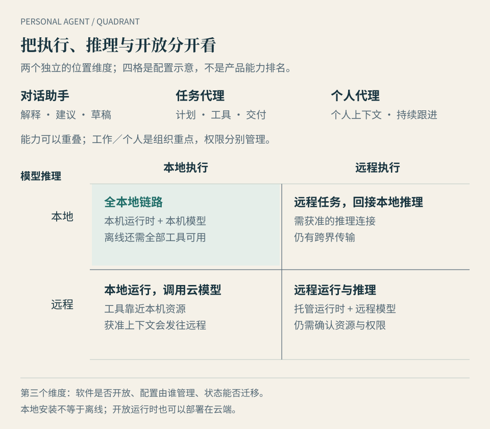

# 第 2 章 · 一张地图，分清助手、工作代理与个人代理

*图 2-1 · 用二维矩阵分开执行与推理位置。四格为配置示意，能力范围允许交叠；软件开放程度、控制方式与产品是否支持相应连接，需要另外核对。*

**这一章先回答：为什么大家说的 Personal Agent，好像不是同一种东西？**

## 名词先帮你提问，不急着替产品归类

打开三个产品介绍，你可能读到“个人助手”“自主智能体”和“数字同事”。它们也许都能搜索、处理文件、操作工具。名称不同，功能又重叠，似乎没有办法划清边界。

可以换一种做法：先看它把什么当作一件工作，再看工作如何持续。

如果主要交付解释和草稿，你面对的是以对话为入口的助手。如果接到一个目标，能够执行步骤并交付结果，它表现出任务代理的能力。如果还能围绕一个人的背景、习惯和长期目标持续跟进，就进入本书讨论的个人代理范围。

这些范围会交叠。同一款产品可以既回答问题，也执行一次任务，还保留长期上下文。一个聊天界面里可以住着代理；一个装在电脑上的应用，也可能只提供对话。界面长什么样，不足以确定分工。

因此，本书不会把“网页型只能做轻任务”“换了窗口一定没有记忆”当成通用事实。具体要检查产品是否保存状态、怎样调用工具，以及一个任务结束后哪些资料还能延续。

## 工作代理与个人代理，区分的是组织重点

Coding Agent 通常围绕代码仓库、文件、终端和验证工具组织工作。更宽泛的 Working Agent，可以围绕文档、表格、设计或业务流程交付成果。为了完成这些任务，它们也可能记住规则、定时执行、连接消息渠道。

个人代理把另一个对象放在中心：某个人，以及这个人跨任务的安排和偏好。林岚不只想完成一封邮件，还希望后来的酒店回复、会议变化和出发提醒都能接回同一件事。

两者共享很多技术，区别往往在默认工作单位：一个项目、一份交付物，还是一段持续关系。这是理解产品的起点，不是不可跨越的边界。

有一种选购建议是“生活用 Personal Agent，生产工作用 Working Agent”。它有实践价值：代码和业务任务需要专门工具、清楚规则和结果验证；个人事务则重视背景与连续性。但如果把建议当成定义，就会遗漏用个人代理处理经营事务的人，也会遗漏能承担日常任务的工作代理。

更稳妥的判断是：**技术能力可以重叠，工作与生活的数据权限仍需分别管理。** 林岚希望代理知道自己周五出差，不意味着它可以在给客户的邮件里自由引用家庭安排。

| 名称 | 主要观察对象 | 容易混淆的地方 |
| --- | --- | --- |
| 对话助手 | 解释、生成与交互 | 有些助手也有记忆和工具，不能仅凭聊天框判定能力 |
| 任务代理 | 一次目标到一次交付 | 后台完成一件事，不等于能长期跟进个人事务 |
| 工作代理 | 项目、专业工具与成果 | 能用于生活；“工作”也不自动保证执行不会出错 |
| 个人代理 | 个人上下文与持续事务 | 能用于工作；“个人”不等于只能聊天或只办生活琐事 |

## 本地派与云端派，是一条独立的分类轴

现在再问：代理在哪里运行？

本书说的**本地部署，Local Runtime**，指负责维持任务状态、调度工具和执行操作的代理程序，运行在用户自己的电脑、设备，或其管理的局域网环境里。我们把围绕这种运行方式形成的应用取向称为“本地派”。OpenClaw、Hermes 的本地部署，是本书的代表案例。

**云端运行，Cloud Runtime**，指代理的主要运行环境在远程基础设施上。Muse、Dot（Dots）等平台托管服务，是本书“云端派”的代表。云端也可以由用户自托管，不能把远程运行都理解为同一种商业平台。

**混合运行**则把角色分开。例如，云端负责接收消息和持续调度，本地组件执行指定设备上的操作。反过来，本地代理也可以调用云端模型和远程服务。

这条轴回答“资源和程序在哪里”。它不直接回答哪个代理更聪明、更自主，或用户更有控制权。

## 本地派为什么有独立地位

云端服务能降低配置门槛，并让代理在用户设备休眠时继续运行。但有些工作受资源位置和使用条件约束，纯云端执行无法直接替代。

**本机已有环境。** 林岚有一份私有资料，在本机文件夹里；一个专门的软件只装在办公室电脑上。把文件上传未必足够，因为工作还依赖本机插件、许可证、登录状态或与其他工具的连接。需要在原环境执行时，本地运行时有直接的资源入口。

**私有网络和设备。** 一套内网系统、一台 NAS、一件通过局域网或物理接口连接的硬件，不会自动向平台云电脑开放。访问可能需要本地执行组件、专门网络连接或设备接口。能否办事取决于这些条件，而不只取决于模型。

**资料不能外发。** 若规则要求相关资料不离开受控环境，就要同时检查模型推理、工具调用、日志和其他数据流。满足这些条件时，本地方案可以承担相应工作；仅把代理安装在电脑上并不能满足全部要求。

**网络不可用或受到限制。** 某些任务可以在本地完成，但前提是模型、所需工具和任务资源都已在本地可用。一个依赖外部模型 API 或在线搜索的代理，不会因为本地安装就突然具备完整离线能力。

**用户需要改变运行规则。** 自定义工具、指定执行环境、审查日志、选择模型和保存可迁移的配置，都可能成为研究、开发或个人流程的重要需求。这种控制可以有实际价值，也伴随维护责任。

以上是场景条件，不是宣布 OpenClaw 或 Hermes 已开箱支持所有桌面应用和设备。具体接口、工具及权限仍需配置和验证。

从生态看，本地派围绕用户已有环境、开放工具和可调整的运行方式积累价值。它并不需要先变成一家覆盖全部生活服务的平台，才能成立。

## 云端派的价值也很具体

对于主要依赖在线邮箱、日历和网页的任务，托管服务提供了另一种便利：用户不必自己保持机器运行，不必处理每一次更新与故障，可以从不同设备接回持续工作。

云端生态往往围绕账号、连接器、应用入口、计费与厂商的运行控制展开。你购买的不只是一组模型回答，也包含持续计算、存储和运维服务。

这种便利的代价，是受制于服务可用性、开放地区、连接范围、额度和迁移方式。云端电脑有浏览器，也不意味着所有网站都允许自动化访问，或它已经拥有所有应用的使用资格。

本地与云端不是必经的前后两代。它们分别适配不同的资源和维护条件，也能相互扩展。云端服务若通过经授权的本地组件使用本机资源，应当把这部分混合架构说清楚；它依然需要本机在线和相应权限。

## 再把三件常被混在一起的事拆开

第一件是**运行时在哪里**。谁在保存任务状态、调用工具、推动下一步？

第二件是**模型在哪里推理**。任务信息交给本地模型，还是发送到外部服务？

第三件是**软件与生态是否开放**。用户能否检查、修改、迁移运行程序及配置？模型能否更换，资料能否带走？

这三件事能够组合。OpenClaw 的文档包含远程访问、节点和本地模型等不同配置方向；Hermes 的官方页面同时提供本地安装与可选云端部署。[1](https://docs.openclaw.ai/) [2](https://hermes-agent.nousresearch.com/)

腾讯 LightVela 还提供一个直接交集：其官方文档说明个人助理在云端运行 Hermes Agent。因此，“Hermes 是本地派代表”和“有人在云端托管 Hermes”可以同时成立，前一句讨论的是本地部署方式，并非为品牌划定唯一位置。[3](https://lightvela.com/docs)

| 组合 | 运行时 | 模型 | 需要特别检查什么 |
| --- | --- | --- | --- |
| 本地代理调用远程模型 | 本地 | 云端 | 发给模型的内容，工具与日志的数据流 |
| 本地代理使用本地模型 | 本地 | 本地 | 其他在线依赖、工具权限及本机资源 |
| 用户自托管代理 | 自己管理的服务器 | 可选择 | 服务器运维、网络访问和模型费用 |
| 平台托管代理 | 厂商云端 | 由产品决定 | 账号权限、额度、数据管理与迁移 |
| 云端调度、本地执行 | 云端与本地 | 可组合 | 本地组件在线条件、连接权限和执行范围 |

看到“数据在本地”“可以换模型”或“开放协议”时，最好把它们变成具体问题，而不是一揽子信任结论。

## “广义”和“狭义”，为什么有时有用、有时碍事

一种常见解释，把具备持续记忆、消息入口和调度能力的系统都纳入广义 Personal Agent；再把每人拥有托管云电脑、开箱即用的服务称作狭义 Personal Agent。

它能突出一项真实变化：厂商承担了原本由用户承担的运行与维护工作。对于不想配置设备的人，这个区别很重要。

但如果继续把本地称作旧一代，把托管云端称作下一代，就容易把资源位置误当成能力等级。它也难以解释开放运行时的云端托管，以及需要本地执行的混合产品。

因此，本书会在引用他人用法时说明“广义、狭义”各指什么，正文比较则优先使用具体维度。你不必记住一套世代名称，只需要知道：它能持续什么，能访问什么，谁来维护，边界如何管理。

## 一张地图怎样帮你选择

同样是“每周整理一份报告”，不同资源会导向不同起点。

资料来自公开网页，结果写进在线文档，平台托管可能更方便。资料主要在本机软件和内网系统里，本地执行能力就成为必要条件。若既要全天候接收外部变化，又要使用内网资源，就需要认真考虑混合方式。

如果整个流程固定、少有例外，一个日历提醒或简单脚本也可能够用。加入代理的理由应当是需要解释变化和组织步骤，而不是所有自动化都必须换一个新名称。

你已经可以把下一款产品放到地图上：先确认任务范围，再确认持续性，随后标出运行位置、模型位置与控制方式。下一章将用这张地图看今天的代表产品。它们的名字很多，但面向的麻烦并不相同。

## 本章来源与边界

1. [OpenClaw 官方文档](https://docs.openclaw.ai/)，用于核对自主管理、远程与本地模型等配置方向。
2. [Nous Research：Hermes Agent](https://hermes-agent.nousresearch.com/)，用于核对本地及可选云端部署、记忆和软件与服务成本的区别。
3. [LightVela 官方产品文档](https://lightvela.com/docs)，用于核对腾讯轻量云团队归属及云端运行 Hermes 的说明。

资料观察日期为 2026-10-10。LightVela 文档已在本次目录修订时读取，出版构建前再次抓取超时，故保留当次读到的有限描述；不据此更新套餐和平台范围。本章分类、表格和场景推演属于本书解释框架，具体产品是否支持某项本机或内网任务需另行验证。
