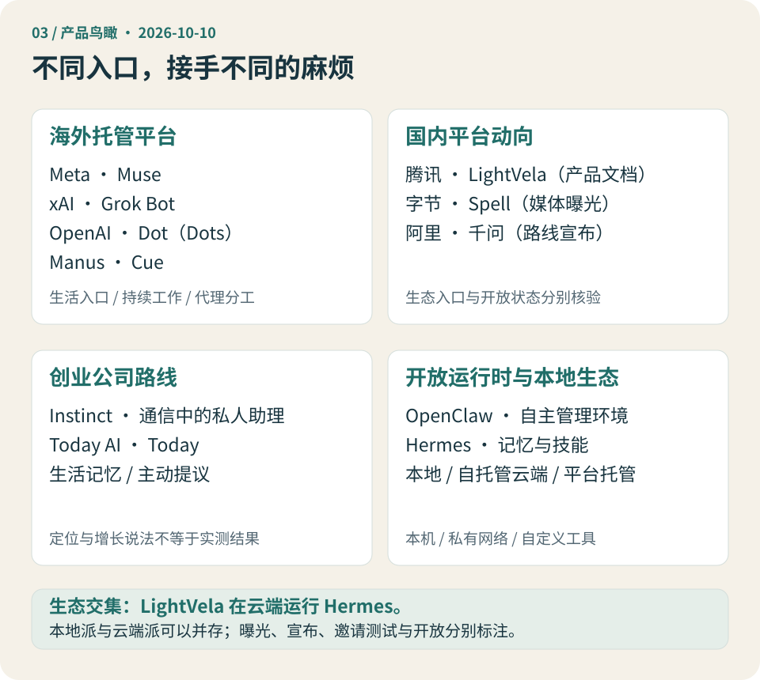

# 第 3 章 · 今天的产品版图：不同公司，正在解决不同的麻烦

*图 3-1 · 产品与生态鸟瞰，资料观察截至 2026-10-10。位置代表主要观察方向，允许交叠；曝光、宣布与可用产品并不处在同一证据层级。*

**这一章先回答：面对这么多名字，我应该先看哪一类？**

## 从四类麻烦进入市场

第一类是生活事务：安排、购物、沟通、预约和等待回复。用户通常希望有一个容易联系的对象，少打开几个应用。

第二类是持续知识工作：资料不断出现，分析需要更新，项目跨越数天。用户看重背景能否延续，以及结果能否接回正在进行的工作。

第三类是重复业务流程：每周收集资料、整理线索、准备对外沟通。任务有一定规律，但又存在需要判断的例外；职责分工和可复用流程变得重要。

第四类是自己的执行环境：本机应用、私有文件、内网、设备，以及需要自己定义的工具。这里的首要问题是资源可达性、数据条件和控制权。

四类麻烦并不对应四个互斥产品类别。独立经营者可能同时遇到全部四类。下面的鸟瞰，就是看不同产品选择从哪一类问题先进入，再观察它能否延伸到其他地方。

## 海外平台：把持续代理做成服务

### Muse：从生活入口开始

Meta 于 2026 年 9 月 8 日发布 Muse。公告描述了专属云端 VM，以及应用和 WhatsApp 入口，首发面向美国。它把持续生活事务作为重要方向。[1](https://about.fb.com/news/2026/09/introducing-muse-personal-ai-agent/)

对用户而言，值得检验的是它能否接住事务的后半段：信息变化后更新安排，等到回复再处理，把需要决定的问题带回来。熟悉的聊天入口可以降低开始使用的摩擦，但不能替代对访问范围、执行结果与资料来源的检查。

因此，Muse 在本书地图上的位置是“托管云端、生活入口”。这是一种产品定位，不是认定它已经覆盖所有地区或所有生活服务。

### Grok Bot：围绕职责组织持续工作

xAI 的 Grok Bot 文档以有名字、有职责的 Bots 组织长期工作，并提供协作、技能和例行任务。需要留意一个明确细节：同一账号的 Bots 共享云电脑中的文件、浏览器会话与登录；不同角色不等于完全独立的环境。[2](https://docs.x.ai/grok-bot/overview)

这个选择有双重效果。交接时不必反复复制资料和重新登录；与此同时，你也不能仅靠给“财务 Bot”和“内容 Bot”换名字，就获得安全隔离。

它的观察重点，是职责分工能否减少人做传话人的次数。几个角色看起来很忙，没有用户少介入的证据，还不足以说明它创造了净收益。

### Dot（Dots）：围绕一个人的工作延续上下文

OpenAI 于 9 月 29 日宣布 dots，从用户的主 dot 开始，面向符合条件市场的 Pro、Business Premium 等计划分步开放，并有企业测试安排。其公开设计强调持续上下文与云端工作环境。[3](https://openai.com/index/introducing-dots/)

本书用 **Dot（Dots）**帮助读者识别名称；引用官方产品名时保留小写 **dots**。

它值得观察的是“上一件事怎样进入下一件事”：项目背景是否保留，纠正能否影响后来交付，任务换到另一个工作环境后，结果和状态能否顺利回到主入口。连续性是一种需要逐项检验的体验，不能仅凭“集成”二字认定已经无缝。

### Cue：让代理参与外部沟通

Manus 在 9 月 28 日的 2.0 发布材料中介绍了独立应用 Cue，强调每个代理的邮箱、电话、钱包和电脑，以及代理间的交接。发布时为邀请制早期体验。[4](https://manus.im/blog/introducing-manus-2-0)

这样的定位让人首先想到需要异步沟通的事务：代理发出请求，对方第二天回应，它仍然能接着办。邮箱和电话可以提供持续联络入口，但实际服务覆盖、费用和权限还要逐项核对。

拥有联络标识和钱包，也不等于代理已经成为独立法律主体。它仍是在用户和服务规则所设边界内行动。一个功能展示不能证明每个商家、地区和支付场景都接受这种方式。

## 国内动向：生态入口重要，开放状态同样重要

对中文读者，能否进入常用软件、能否顺利注册和支付，往往比一次演示快几秒更影响日常可用性。国内产品值得关注，正因为它们可能更靠近这些资源入口。但“更靠近”是一条需要验证的路线，不是先验的覆盖承诺。

### LightVela：开放运行时进入托管服务

腾讯 LightVela 的官方文档将其归于腾讯轻量云团队，说明用户的助理在云端运行 Hermes Agent。这使它成为本地与云端生态交集的一个具体案例。[5](https://lightvela.com/docs)

它提供了一种介于“自己部署开放运行时”和“使用整合平台服务”之间的观察方向：厂商接手运行环境，用户仍通过配置模型和工具组织助理。具体配置自由度与数据迁移能力，应回到当前产品文档检查。

不要把“基于 Hermes”写成“腾讯自研 Hermes”，也不要因为 Hermes 能本地部署，就把 LightVela 归为本地运行。运行时来源和实际部署位置分别回答不同问题。

### Spell：先记录曝光，再等待产品事实

9 月 29 日的报道援引知情人士称，字节豆包团队从 4 月起内测个人助理方向的探索产品，项目代号为 Spell，并计划推动对外发布。[6](https://finance.eastmoney.com/a/202609293886383142.html)

截至本版的核查范围，我们将它标为**媒体曝光与内测线索**。不能把代号当成已经固定的最终品牌，也不能据此填上套餐、开放范围和实际完成率。

Spell 应当进入产品版图，因为它说明一个重要平台正在探索这个方向。它暂时不适合与已经可体验的产品一起做功能评分。后续需要跟踪正式名称、发布安排，以及个人代理和既有手机助手的关系。

### 千问 Personal Agent：路线宣布与阶段性进展

新华网 9 月 23 日报道，千问在前一天的云栖大会上宣布加速打造 Personal Agent，并公布个人数据接入等阶段性进展。[7](https://www.xinhuanet.com/tech/20260923/b6ca9928f19f42f4ab9133e98cc3164c/c.html)

这能支持“已公开宣布方向并展示部分进展”，不能自动改写成“一款独立个人代理已向所有用户开放”。模型能力、应用功能和长期代理形态，也需要分别核对。

本书将它放在国内平台路线中观察：既有服务生态能否转化为一段持续、可授权的个人工作关系？产品真正开放后，再比较任务连续性、资源覆盖和控制方式。千问办公则应按工作场景理解，不能拿它的表现代替个人代理形态的成熟度。

## 创业路线：新的入口和使用节奏

### Instinct：把私人助理放进通信

Instinct 创始人 Noah Shinn 参加的 *Invest Like the Best* 节目于 9 月 28 日发布。节目介绍把产品描述为通过通信联系的私人助理，并称邀请制服务约有 **10% 的日增长**。[8](https://podcasts.apple.com/zm/podcast/noah-shinn-building-instinct-the-personal-agent/id1154105909?i=1000792019848)

这是一个值得记录的早期信号，但需要把“找到出处”和“验证数字”分开。本版核对到的是节目介绍，尚未拿到可独立核验的基数、统计区间与完整指标定义，因此保留为访谈中的增长说法。它不等于长期持续增长，更不等于用户满意度或付费留存。

对这条创业路线，更有价值的问题是：当用户主要通过熟悉的通信方式联系代理，操作门槛下降了，任务状态和控制范围是否仍然清楚？少一个界面可以方便开始使用，也可能要求更好的结果说明。

### Today：围绕一天的连续性

Today AI 的 Today 在官方介绍中强调可查看和调整的生活记忆、主动提议与确认后的执行，围绕日常安排组织交互。[9](https://today.ai/articles/zh-Hans/blog/what-is-today)

它提醒我们，个人代理不只可以按“替我完成多少个任务”设计，也可以围绕“每天何时带回什么信息”建立习惯。晨间简报和晚间回顾是否有用，关键在于信息是否与当前安排相关，而不是每次生成很多内容。

这仍是厂商定位，不是本书实测结论。桌面或手机客户端也不能证明主要运行时、模型或全部资料都在本地；观察部署方式，仍要检查实际数据流。

## 本地派与开放生态：环境本身就是价值

### OpenClaw：把工具放回自己的环境

OpenClaw 的公开文档涵盖消息入口、工具、节点、远程访问及模型配置等方向。用户可以围绕自己的运行环境组织代理，而不是只使用一套固定的托管产品入口。[10](https://docs.openclaw.ai/)

在本地部署场景，它的观察重点是：已有文件、工具和私有资源能否在清楚的权限内参与工作。配置与扩展的自由，需要落实到实际可用的工具，也会带来更新、备份和故障处理的责任。

本地派的独特价值由这种资源关系产生。只要任务依赖本机应用、内网或设备，纯云端服务就不能仅靠更强模型直接取代它；连接这些资源时，云端也需要引入相应本地或私有网络条件。

### Hermes：把运行方式与工作积累分开

Nous Research 的 Hermes Agent 官方页面提供本地安装和可选云端部署，介绍跨会话的记忆与技能，并明确区分免费开源软件、模型服务和可选托管成本。停止本地进程时，需要活跃代理的任务不会继续运行。[11](https://hermes-agent.nousresearch.com/)

这两点足以解释它在本书地图上的位置：开放运行时能让用户保留和调整工作环境，但持续在线仍需要有人承担运行条件。

你可以选择本地运行，也可以选择自己的服务器，或使用 LightVela 等托管形态。迁移后哪些配置、记忆和工具还能使用，需要看具体实现，不能因为软件开放就宣布没有迁移成本。

## 把产品放在同一张表里，不把证据混成一层

下面是本版的定位快照。它比较“应该从什么问题看这个对象”，没有给出市场份额、模型强弱或综合名次。状态描述受本次查到的资料限制。

| 产品或项目 | 主要观察方向 | 本版记录的公开状态 |
| --- | --- | --- |
| Meta Muse | 托管生活代理与通信入口 | 官方发布；首发有地区范围 |
| xAI Grok Bot | 持续角色、职责分工与流程 | 当前官方文档及订阅准入说明 |
| OpenAI Dot（Dots） | 个人上下文与持续工作 | 官方发布，分计划与市场开放 |
| Manus Cue | 代理联络身份与异步事务 | 发布材料中的邀请制早期体验 |
| 腾讯 LightVela | Hermes 运行时的云端托管 | 官方产品文档，实际套餐另核 |
| 字节 Spell | 国内个人助理探索 | 媒体曝光与内测线索 |
| 千问 Personal Agent | 平台生态与个人服务路线 | 公开宣布与阶段性进展 |
| Instinct | 通信中的私人助理 | 访谈描述的邀请制服务 |
| Today AI 的 Today | 日常连续性、记忆与提议 | 厂商公开产品介绍 |
| OpenClaw | 本地与自主管理的工具环境 | 公开文档及可部署运行时 |
| Hermes | 开放运行时、记忆与技能 | 本地安装与可选云端部署 |

想尝试某一项之前，仍需要确认今天的账号资格、地区、平台和费用。尤其不能把“官宣未来方向”与“你现在能用”画上等号。

## 怎样读下一份宣传资料

先找三种单位。

**工作的单位**是什么：一轮问答、一个任务、一个项目、一个角色，还是一个人的持续安排？这决定了它在哪里可能减轻你的负担。

**资源的单位**是什么：云端电脑、本机环境、连接器、模型调用，还是代理自己的联络标识？这决定了它可以接近哪些事情，又需要什么条件。

**收费与控制的单位**是什么：订阅、额度、任务、运行资源，还是附加服务？“可以开始使用”与“可以持续承担全部工作”并不相同。

再分开四类证据：厂商说能做、产品演示做过、某位用户做成、本书或独立研究在相同条件下重复验证。它们各有用途，不能互相替代。

三份研究素材对价格、架构和定位存在分歧。以 Grok Bot 为例，多角色看起来像多台独立电脑，但当前文档明确写了共享环境。这个事实会影响权限理解。对于“多代理是否省心”，不同体验却可能都成立：有清楚流程的人省下交接，没有清楚职责的人增加协调。前一种冲突需要查证，后一种分歧需要解释条件。

因此，本书珍视矛盾，但不会把所有矛盾都当成可供挑选的观点。

## 第一篇结束时，你应该拿走什么

现在你不必记住十一项产品的全部功能。更重要的是，你已经有一套能随产品变化继续使用的问题。

个人代理承接的是跨工具、跨时间的事务。它是否有价值，要看结果与新增管理成本；它是否适合你，要看任务资源和授权条件。本地派、云端派及混合部署分别适配这些条件，开放运行时和平台服务也可能交叠。

产品竞争仍在形成。海外平台、国内入口、创业交互和开放生态，各自在争取用户的一部分工作。你可以先从自己一件反复发生的麻烦出发，再选择合适的运行方式和产品，而不必先宣布某家公司已经赢了。

第二篇将沿着这张地图，展开托管、本地、工作循环、选购、日常使用与授权边界。第一篇先到这里，让我们有机会检查：这张地图是否准确，是否足以帮助你判断一款新产品。

## 本章来源与边界

1. [Meta：Introducing Muse](https://about.fb.com/news/2026/09/introducing-muse-personal-ai-agent/)，官方公告。
2. [Grok Bot 官方概览](https://docs.x.ai/grok-bot/overview)，官方文档，更新标记 2026-10-07。
3. [OpenAI：Introducing dots](https://openai.com/index/introducing-dots/)，官方公告，2026-09-29。
4. [Manus：Introducing Manus 2.0](https://manus.im/blog/introducing-manus-2-0)，官方发布材料，2026-09-28，Cue 段落及准入说明。
5. [LightVela 产品文档](https://lightvela.com/docs)，官方说明；本次目录修订已读取，构建前重访超时。
6. [东方财富：豆包将推个人助理产品](https://finance.eastmoney.com/a/202609293886383142.html)，2026-09-29，转载媒体曝光，不是厂商发布公告。
7. [新华网：千问加速打造 Personal Agent](https://www.xinhuanet.com/tech/20260923/b6ca9928f19f42f4ab9133e98cc3164c/c.html)，2026-09-23，记录前一天的宣布。
8. [Invest Like the Best：Noah Shinn — Building Instinct](https://podcasts.apple.com/zm/podcast/noah-shinn-building-instinct-the-personal-agent/id1154105909?i=1000792019848)，2026-09-28；本版使用节目介绍，增长讨论章节标记 50:03，数字未独立核实。
9. [Today：Today 是什么](https://today.ai/articles/zh-Hans/blog/what-is-today)，厂商介绍，2026-09-15。
10. [OpenClaw 官方文档](https://docs.openclaw.ai/)，运行时与工具配置资料。
11. [Nous Research：Hermes Agent](https://hermes-agent.nousresearch.com/)，官方页面及常见问题。

观察日期为 2026-10-10。除注明读取限制者外，上述页面均已通过公开检索读取。定位与比较问题是本书分析；没有统一实机测试，不据此评出完成率、口碑或性价比排名。
