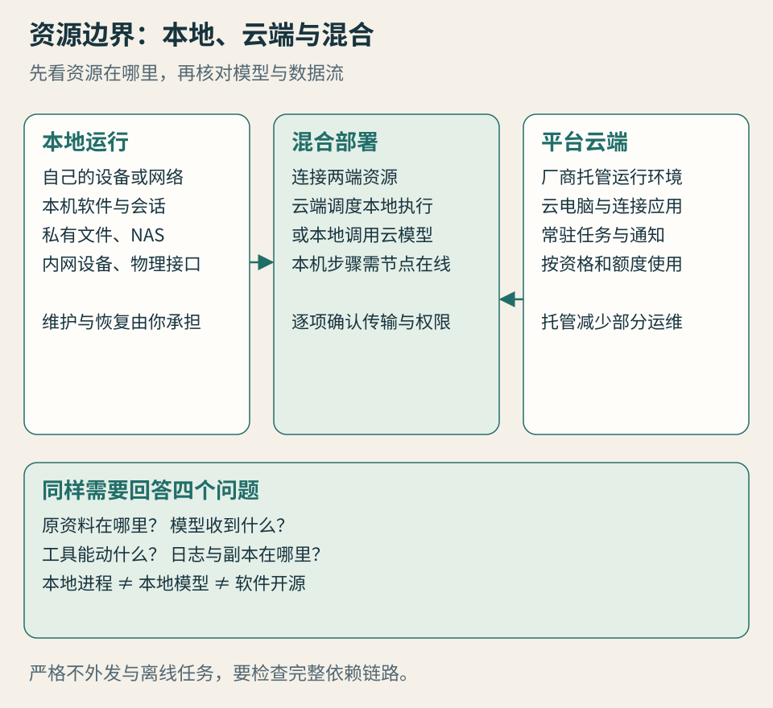

# 第 5 章 · 本地派：云端派不能直接替代的场景与生态

*图 5：运行位置决定资源入口；模型位置与外发范围还要另行确认。*

本地部署（Local Runtime）的意义，首先是让执行过程靠近你的资源：已经装好的应用、不能公开的文件、只在内网开放的设备，以及由你决定的运行规则。以 OpenClaw、Hermes 为代表的开放运行时，让你可以自己选择部署与连接方式，也让维护责任落到自己手上。

本章回答：**哪些事情需要在自己的设备或受控网络里做？** 这些任务不会因为云端代理更容易上手就消失。

## 本地派拥有自己的生态地位

如果林岚只需整理公开景点资料，云端环境可能足够。如果她要整理本机设计软件里的工程文件，核对工作室 NAS 的版本，再从局域网打印机输出清单，情况就变了。纯云端电脑不会自动拥有那些本机软件、会话、网络路线和硬件接口。

你可以建立受控连接，让云端调度本地组件。连接之后，方案属于混合部署：本地的一端仍在承担访问与执行。这体现了本地组件的价值，不能据此宣布本地已经被云端替代。

也有任务更适合自己的长期环境。你积累的目录结构、工具脚本和运行日志，可能已经构成工作流程。每次为了新平台重新上传、重连、解释，都会产生迁移成本。本地派提供一种把流程留在自己可管理环境中的路径。

但“留在自己的环境”不是所有问题的答案。机器故障、误配置和缺少更新一样会影响工作。真正的优势在于资源与控制条件，是否值得承担维护，需要结合任务判断。

## OpenClaw 与 Hermes 提供了什么

**OpenClaw** 的文档围绕连接渠道、运行环境、工具、状态与访问控制组织能力。你可以把它部署在自己的设备或服务器，再选择模型和连接的工具。网关管理连接和凭证，并不代表一安装就获得安全隔离；当前信任边界文档明确写到沙箱默认关闭，实际可达资源受工具、挂载和网络配置影响。[OpenClaw 信任边界](https://docs.openclaw.ai/start/why-openclaw/the-trust-boundary)

**Hermes** 强调终端与工具使用、会话记忆、可复用技能和多种模型选择；开源软件可自托管，也有托管服务。项目的“免费”描述针对软件使用，不表示模型、硬件和维护没有成本。长任务是否持续运行，还取决于进程、设备和连接是否保持可用。[Hermes 官方说明](https://hermes-agent.nousresearch.com/)

这两类运行时的共同机会，是让你参与决定“接哪种模型、开放什么目录、使用哪些工具、保留什么状态”。具体工具是否支持某个设计软件、NAS 或硬件，需要适配与验证。开放性提供可扩展的空间，不能代替已经适配好的功能。

初次接触的人应先理解边界，安装步骤留待附录。仅为每周整理几份公开资料而维护一整套复杂环境，可能得不偿失；已有稳定自托管工作流的人，则不必因为新的云端入口出现就全部迁移。

## 四类纯云端不能直接接手的任务

### 本机应用、私有文件与现有会话

专有软件可能依赖本机许可证、插件、特殊格式或已经登录的桌面会话。只上传导出的 PDF，代理能处理的是 PDF，无法据此保证能编辑原工程。浏览器中已登录的工作界面，也不能自动搬到另一台云电脑。

本地执行组件可以通过合法、已授权的接口处理这些资源。比较方案时，应确认它操作的是原文件、导出副本，还是屏幕上的界面；哪些格式能够保存回去；失败后会不会损坏原件。先在副本上验证，再开放有限写入。

### 内网、NAS 与硬件

家庭 NAS、工作室服务器、只对内开放的设备，可能没有公网入口。串口设备、采集卡或打印机更涉及物理接口。没有本地节点或合规的网络连接，远端代理无法直接调用它们。

“把服务暴露到公网”不应成为所有困难的默认解法。你可以在受控网络内执行，也可以使用经过审核的连接方案；是否允许建立连接，要遵循资源所有者的要求。本地运行的优势，是不必为了远端访问而先改变资源的边界。

### 严格不得外发的资料

假设项目规定完整客户资料不能传到外部服务。你把代理装在本机，却把原文送给外部模型，依然不满足这项要求。模型请求之外，搜索查询、嵌入服务、插件、崩溃日志与诊断信息，也可能带出片段或标识。

符合“不外发”的方案，需要核对推理、工具、检索与日志的整条链路，按要求选择本地模型或被允许的受控推理服务，并限制网络出口。如果组织允许在其私有云处理，受控云也可能满足政策；“受控”不能机械等同于个人笔记本。

### 断网时仍要完成的任务

离线整理本地文档、转换格式、查询本地索引，可能适合全本地依赖。前提是模型、运行时、工具、必要数据与授权方式都已经具备，任务无需在线查询或远端验证。

本地代理调用云模型时，网络断开仍可能无法工作。设备上的客户端图标、开源许可证和本地日志，都不能证明它具备离线能力。离线任务要在断网条件下验收，并且只要求它完成离线可完成的目标。

## 三件容易混在一起的事

| 你确认的事实 | 能说明什么 | 仍然不能推导什么 |
| --- | --- | --- |
| 代理进程在本机 | 一部分状态与执行发生在本机 | 模型也在本机，所有数据都不外发 |
| 使用本地模型 | 推理可在本地完成，取决于配置 | 所有搜索、插件和日志都留在本地 |
| 软件开源 | 可查看、修改和部署相应代码 | 默认安全、零成本、所有状态可迁移 |

OpenClaw 的模型文档列出本地模型服务与自定义端点等配置路径。这支持“模型位置可选择”，不能保证你的机器性能、工具调用表现或离线任务已经达标。更换模型之后，应重新验证格式遵循、工具调用和结果质量。[本地与自定义模型服务](https://docs.openclaw.ai/concepts/model-providers/custom-providers)

输入素材把自托管分别解释成“绝对数据主权”与“更多控制但更多维护”。本书保留前者提出的愿望，同时采用可检验的说法：你掌握了哪些文件、模型请求、凭证、导出和升级决定？掌握多少，要看实际配置。控制权来自可落实的能力，不能只由部署标签授予。

## 混合部署不是模糊地带

两种常见组合值得明确命名。

**云端托管开放运行时**：LightVela 在云端运行 Hermes，减少用户部署工作。它继承开放运行时的一部分方法与工具生态，但运行主机由服务方托管。开放软件与云端运行，在这里同时成立。[LightVela 文档](https://lightvela.com/docs)

**云端调度、本地执行**：云端保留任务进度，本地组件访问获准目录或应用。你可能获得持续通知与本机资源的组合，但本机关闭以后，需要它执行的步骤仍会等待。云端能继续规划，不表示本地动作也完成了。

还有**本地运行时、云端模型**。这种配置可以让文件工具靠近本机，却会在推理调用时向外发送所需内容。应先缩小读取范围，再明确哪些片段会传给模型；需要零外发时，这个组合就要重新设计。

画数据流时，不必掌握复杂架构术语。只要写清四行：原资料在哪里；模型实际收到什么；工具实际能动什么；运行日志与副本保存在哪里。说不清的部分，就是继续核查的地方。

## 自托管的真实成本

你需要为故障恢复、系统更新、备份、模型费用、硬件与运行时间负责。笔记本休眠、磁盘满了、登录失效、依赖升级，都会让“常驻代理”失去常驻条件。长期使用要有能发现失败、保存状态与恢复任务的机制。

成本可以分成两栏。金钱栏记录硬件折旧、托管、电力、模型与工具服务；时间栏记录安装、维护、排错、核查和修复。不要把“软件免费”直接写成总成本为零，也不要为了一个漂亮数字把维护时间按任意单价折成钱。

如果你已有稳定的 OpenClaw 或 Hermes 环境，迁移前先列出其中真正有价值的部分：本机工具、目录权限、独特技能、可导出的记忆、习惯的审查流程。云端产品有清晰优势的任务，可以单独迁过去；必须依赖本地的任务，继续留在本地或组合使用。逐项迁移比整套推倒更容易判断收益。

## 本章来源与待确认项

资料观察截至 2026-10-10。来源为 OpenClaw 当前公开文档、Hermes 官方说明与 LightVela 文档；未对安装环境或具体本机应用做统一实测。资源场景为作者分析，每种方案都需验证模型、工具、网络与授权条件。厂商默认配置会变化，应以实际安装版本与生效配置为准。
