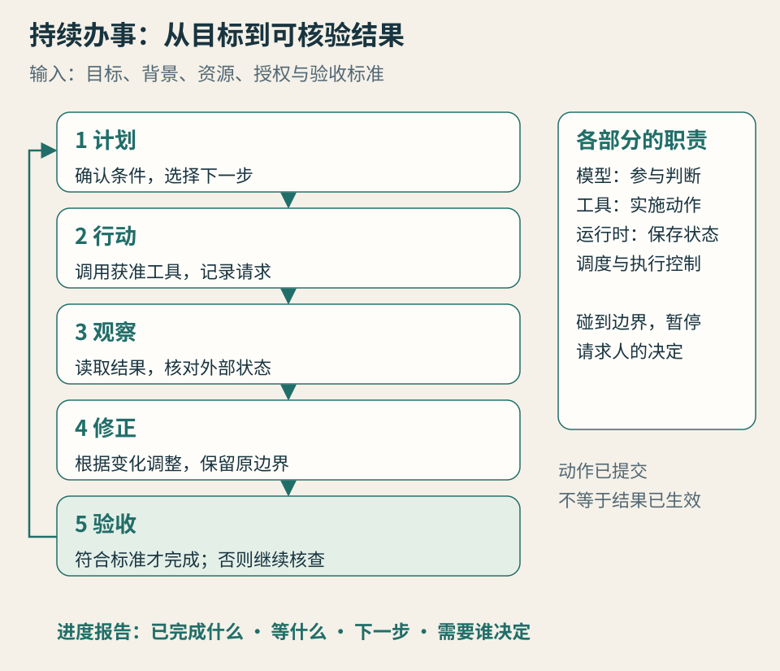

# 第 6 章 · 拆开看：一个个人代理怎样持续办事

*图 6：执行动作与完成任务之间，需要观察、核查和状态更新。*

一次回答主要考验 AI 怎样理解和生成内容；一项持续委托还要保存状态、选择动作、观察变化、处理失败，并判断是否真的做完。它的可靠性由整条工作循环决定。

本章回答：**为什么代理有时看起来很聪明，任务却没有推进？** 把循环拆开，你就能判断它卡在哪里，应该补信息、改权限，还是换工具。

## 五个环节，少一个都可能停住

**计划**：理解目标、资源和约束，选择下一步。林岚要求“改期后仍按预算抵达”，代理先确认新会议时间、原订单与可变更条件。缺少出发城市时，生成一份漂亮计划也无法解决实际问题。

**行动**：调用工具读取邮件、查订单、写草稿或请求变更。行动受工具能力和授权限制。读到价格不等于买到票，生成取消申请不等于订单已取消。

**观察**：读取工具结果和外部状态。表单提交后，系统是否返回编号？邮件发出后，是否送达？网站上的提示是确认还是仅接收申请？代理需要看见这些差异。

**修正**：根据结果调整方案。某票价已经变化，就要重新检查预算；对方没有回复，就按约定等待或提醒。修正应保留目标与边界，不能为了完成任务自行提高预算或扩大访问范围。

**验收**：将实际结果与事先标准比较。最后交给林岚的，应有已确认的安排、费用变化、未完成项和下一步责任。写一句“都处理好了”，本身不构成验收。

这五个环节可以重复很多次，也可能在第一步就应该停下。可靠代理能够说明为什么暂停，以及需要什么信息才能继续。看不见暂停原因时，你会被迫自己重新检查整条流程。

## 模型、工具与运行时各做什么

可以把**模型**理解为参与理解与判断的部分：根据当前上下文提出计划、选择动作、解释结果。模型的判断可能出错，因此执行与验收不能只靠它的自信。

**工具**让动作进入具体系统。浏览器和电脑操作接近人使用界面的方式，覆盖面可能较广，却依赖页面、焦点、布局与登录状态。API 是应用提供的程序接口，通常能用明确字段提交请求和接收状态，但可用动作由接口本身决定。

**运行时（Runtime）**负责把这些环节接起来：管理任务、调用模型和工具、保存状态、实施配置与调度。它可以在本机、服务器或平台环境中运行。模型很强，运行时却没有可靠保存任务状态，长任务仍会断。

**MCP（Model Context Protocol）**为工具与上下文连接提供共同协议。它可以减少接入方式的差异，让客户端发现并调用服务提供的工具；协议本身不会让工具结果可信，也不会替所有应用决定权限。本章采用 2025-06-18 版工具规范解释这个角色，不把它当作所有厂商都已实现的统一标准。[MCP 工具规范](https://modelcontextprotocol.io/specification/2025-06-18/server/tools)

因此，“支持电脑操作”“支持 API”“支持 MCP”不能直接比较成三个能力等级。你要问的是：需要的动作有没有可靠接口，结果能否核验，权限能否限制，失败时是否可恢复。

## 执行位置与推理位置分别画

任务的文件工具可能在你的电脑上，模型却在远端；也可能由云端运行时调用本地节点。你看到一个统一对话框，不代表处理链路都在同一个地方。

以项目归档为例：本地工具读取文件 → 运行时选择片段 → 远端模型提出分类 → 本地工具把副本写到暂存目录。这个流程具备本地执行能力，也发生了资料外发。若规则不允许外发，就需要改变推理方案或发送内容，而非只换一个客户端。

另一个例子是云端代理检查公开航班，发现需要读取本机订单截图。它必须等本地组件在线，或等你提供获准的副本。云端常驻解决的是一部分运行条件，本地资源的可用性仍然独立存在。

## 记忆、状态、技能、定时任务不要混用

| 名称 | 保存或决定什么 | 行程案例中的例子 |
| --- | --- | --- |
| 记忆 | 可能对未来有用的背景与偏好 | 林岚通常避免凌晨航班 |
| 状态 | 这项任务目前走到哪里 | 机票未改，酒店正在等回复 |
| 技能 | 可复用的方法、规则或操作知识 | 查订单条件并生成对比方案 |
| 定时任务 | 何时再次启动哪项工作 | 每天 18 点检查是否收到答复 |

记住偏好，不等于记住任务是否完成。保存一段技能，也不意味着它能自动知道何时使用。设了每天运行的时间，不代表每次都能找到正确输入。

有些产品把多个机制装进“记忆”或“自动化”的统一功能里，读者不必纠结名称。只要追问：它保存了哪些信息，谁能改，何时会用，错了怎么纠正，停了怎么恢复。

Grok Bot 文档把可复用技能与有触发、拥有者和时间设置的例行任务分别介绍。这种区分有助于实践：先完成一次，再把方法固定下来，最后安排重复执行。功能说明仍需与账号连接、权限和失败通知一起验收。[技能、例行任务与自动化](https://docs.x.ai/grok-bot/skills-routines-and-automations)

## 多代理的收益与协调成本

主助手与专业角色的分工，可能让检索、整理、核验并行，也可能让职责更容易解释。适合拆开的任务，通常有清晰输入输出，并且各角色可以在相对独立的范围内工作。

但拆分会引入新的工作：传递约束、同步版本、合并结果、处理相互等待，以及决定谁承担最后验收。如果每个角色都重新理解一遍预算和目的，错误与费用也可能增加。

研究素材在这里有两种观点：一类强调“主代理加专业代理”将成为常态，另一类提醒“你可能只是多了几个需要管理的下属”。本书不把它们合并为一句多代理必然更好。可以先让单代理完成完整流程，再仅拆开真正能减少耗时或改善核验的步骤。

还要分开**职责、上下文和权限**。不同角色可以有不同任务描述，却共享电脑与登录。Grok Bot 的公开共享环境，就是这个区别的具体例子。你可以让“资料员”和“检查员”分工，但不能据角色名推断一方看不到另一方的文件。[Grok Bot 概览](https://docs.x.ai/grok-bot/overview)

一个真正有意义的检查角色，需要明确的证据入口与验收准则。让第二个模型回答“你同意吗”，通常不能替代核对原始订单、出处或文件版本。

## 六种常见停顿，分别处理

**登录与验证**：任务有目标，也有工具，却缺少可用会话。人完成指定登录即可继续，不应把密码随手贴进任务聊天。公开安全文档也将验证码、支付等环节保留给受控的人机交接。[Grok Bot 审批与安全](https://docs.x.ai/grok-bot/approvals-security-and-privacy)

**网站变化或访问限制**：按钮、流程或规则变了，原方法失效。若必须使用该网站，应调整方法或人工完成。绕过资源所有者的限制不能成为默认策略。

**上下文丢失**：任务继续了，但预算、版本或已完成步骤没有保留下来。恢复时先核对状态，补关键事实，不能仅要求“继续”。

**权限不足或范围不清**：工具能做，授权却没有覆盖。补的是明确的动作许可，不能为了省一步将所有权限一次打开。

**用量、并发或设备条件不足**：模型额度用完、本机休眠、任务排队，都会影响持续性。需要说明预计恢复条件，而非重复发送同一指令。

**验收失败**：代理报告完成，实际结果却不符合要求。应回到外部证据，分清是动作未生效、判断出错，还是验收标准本来含糊。不要把所有失败都归结为“提示词不够好”。

## 把循环变成可读的进度

一个有用的进度报告，可以只有四项：已经完成什么；现在等什么；下一步准备做什么；哪里需要你决定。再附关键证据与时间。它比密集展示几十条内部思考更能帮助你管理任务。

对周期任务，还应保存上一轮完成状态与输出位置。下一轮根据变化继续，而非每次从头生成。如果每周简报都重复上周新闻，问题可能在状态与去重机制，未必是模型知识不足。

懂得这个循环以后，选购就有了更具体的依据：你的任务卡在哪一环，候选产品能否补上，而且补上以后会不会增加更多管理工作。

## 本章来源与待确认项

资料观察截至 2026-10-10。MCP 解释以注明版本的规范为依据；Grok Bot 文档用于说明技能、触发、共享环境与审批边界。工作循环和故障分类是作者的解释框架，不表示所有产品都按同一内部架构实现。具体任务的状态持久化、恢复和并发能力仍需实测。
