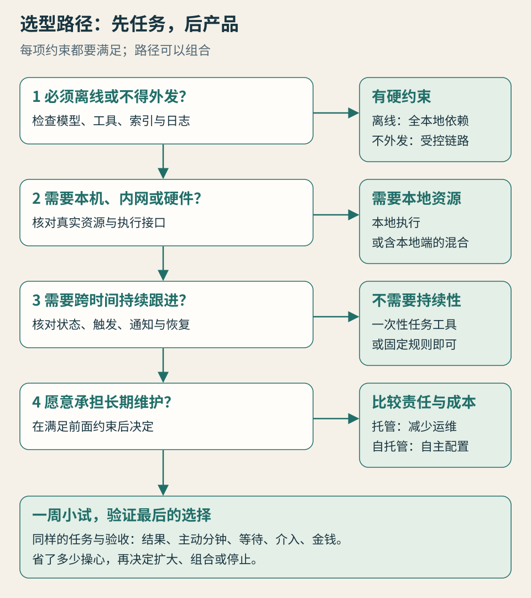

# 第 7 章 · 选购：从你的一件真事出发

*图 7：先排除不满足约束的方案，再比较使用体验。*

选个人代理，可以从一项小委托开始。它最好经常发生、确实让你费心，并且做错以后容易检查和修复。先找到任务，再决定需要什么资源与运行方式，最后比较产品。

本章回答：**怎样避免买到一个很热闹、却没有减少负担的工具？** 用同样的任务试一周，把结果、人工介入和成本一起记下来。

## 先挑一件值得交出去的事

“我想拥有一个私人助理”是愿望，还不是可验证任务。把它缩成“每周五把本周新增的行业资料整理成一页，保留出处”，就能测试结果与管理成本。

好的首个任务通常有三个特征：重复而费心；输入和输出能讲清；风险与修复范围较小。你每个月只做一次、几分钟就能完成的事，可能不足以覆盖配置与熟悉成本。高额付款、重要承诺或无法恢复的原文件修改，也不适合用来摸索陌生产品。

如果暂时没有可说明的重复负担，先继续用现有工具观察一周。记录你在哪些地方复制资料、反复找文件、等待答复或补充背景。真正值得代理接手的工作，经常藏在这些连接处。

## 先看约束，后看品牌

**第一问：资料可以去哪里？** 明确哪些原文、片段、日志和标识可以送到外部服务。若必须离线，模型与全部必要工具都需在本地具备；若只能在组织控制的环境里处理，私有部署或合规的受控云都可能进入候选。不能把“在本机安装”当成已通过数据要求。

**第二问：动作发生在哪里？** 如果依赖本机专用软件、私有 NAS 或物理设备，选择本地执行，或包含本地执行组件的混合方案。纯云端工具若不能合法访问这些资源，就应先排除。

**第三问：任务需要跨时间吗？** 一次性转换几份文档，未必需要常驻个人代理。等待邮件、周期更新与跨设备跟进，则要检查触发、状态保存、通知和恢复。

**第四问：谁承担维护？** 有持续运行需求却不愿维护设备，云端托管往往更值得先试；已有稳定本地服务、模型与工具的人，可以直接验证现有环境。维护意愿不能消除数据和资源的硬约束，冲突时应缩小任务或寻找合适组合。

**第五问：权限能否缩小？** 一个能完成任务却要求过宽权限、又不能有效隔离的产品，可能并不适合这项委托。权限要求属于适配条件，不能等到购买以后才考虑。

## 不同读者，起步任务不同

### 初次尝试的人

先做低风险的资料整理或行程草案，只开放必要输入，保留人工确认。重点看是否减少复制和重复交代，能否清楚解释进度。你不需要为了试用代理先学会运维整台服务器。

如果文件只能在本机处理，也可以从支持明确文件范围的本地工具开始，不必第一天就建立复杂自动化。让一次任务可核验，比一次性接入全部账号更有用。

### 知识工作者

优先验证长期文件、出处与版本管理。代理是否找到最新稿，是否把猜测与资料分开，能否持续保留项目约定，通常比它能写多长更重要。

工作与个人账号最好分别评估。组织允许的应用、数据流与权限，应成为筛选条件；个人套餐能登录，不表示可以处理客户或公司资料。

### 个体经营者与小团队

常见负担是询价、预约、跟进与文件流转。可以先让代理准备名单、核对信息、起草消息，再决定是否开放有限发送。关键结果要落到实际记录，例如确认编号、对应订单和未回复清单。

如果团队多人共同使用，需要额外检查账号归属、谁能授权、谁能看结果、人员离开后如何回收访问。产品名称带“团队”，也不表示这些管理问题都已解决。

### 有技术基础或已有自托管环境的人

直接用现有 OpenClaw、Hermes 或其他工具跑同一项任务，比较它与候选云端服务。模型、工具与运行时可以分别改动，便于找到真正的瓶颈。

避免把“我能配出来”当成“长期成本最低”。把升级、故障恢复和备份时间记下来；如果托管服务确实减少了这些工作，可以只迁移对应任务。

## 中文读者还要确认的条件

中文对话流畅，只能证明一部分语言体验。还需检查中文网站、文件名、日期、时区、联系人与结果格式，尤其是混合中英文资源时能否找到正确对象。

可用性至少涉及账号资格、地区、手机号或实名认证、支付方式、连接的应用与组织政策。某产品公告说有网页入口，不代表任何地区都能购买；某连接器写有微信或邮箱，也不代表能完成你需要的所有读写动作。

试用前列出你日常真正使用的三个资源，例如一个邮箱、一套项目目录、一个日历。逐一确认能连接什么、能做什么、怎样撤销。若只能绕开原工作方式，把所有东西搬到新平台，搬迁成本也要记入试用。

## 一周小试怎样安排

下面是一项每周资料简报的试用设计，不是任何产品的实测结果。

**第 1 天：建立基线。** 自己做一次，记录主动花费的时间、查到的资料、重复和遗漏。写明验收：指定主题与日期范围，一页摘要，每项结论带出处，没找到新信息也要说明。

**第 2 天：完成一次委托。** 让候选方案处理同样类型、数量相近的资料。不要用一份十分钟的任务与自己过去两小时的大项目比较。

**第 3 天：修正一种主要问题。** 例如调整来源范围或去重方式，保存修正。若每次都需从头解释，记录为持续性问题。

**第 4—5 天：再跑两次。** 检查它是否复用了约束，输出是否稳定，以及需要人工介入几次。只增加一项必要变化，便于知道哪里造成失败。

**第 6 天：测试暂停和恢复。** 在可安全恢复的任务中模拟一种条件变化，比如不给新输入或暂时不批准写入。看它能否说明等待原因，不凭空宣布完成。

**第 7 天：决定是否继续。** 检查成果、时间、费用与权限。能持续减少管理工作的任务，再扩大范围；结果价值不足时，可以换方案、缩小委托或停止订阅。

## 用同样的单位比较

| 记录项 | 自己完成的基线 | 使用代理后的记录 |
| --- | --- | --- |
| 结果 | 资料与验收缺项 | 相同标准下的资料与缺项 |
| 主动投入 | 查找、整理、核查的分钟数 | 交代、审批、核查、纠错的分钟数 |
| 等待 | 从开始到可用结果的时长 | 从委托到可用结果的时长 |
| 介入 | 必须亲自处理的步骤 | 补信息、登录、审批与重试次数 |
| 金钱 | 原有直接费用 | 订阅、用量、资源和维护支出 |

主动投入与等待分开。代理运行两小时，你花十五分钟检查，不能写成“你花了两小时”；它十分钟完成、你花四十分钟修复，也不能宣传为“节省了五十分钟”。

**教学数字示例**：自己做一份同等简报需要 60 分钟主动时间。首次用代理，配置 30 分钟，交代 10 分钟，验收与纠错 25 分钟，共 65 分钟。第一次并未省时。之后四次各花 20 分钟，五次合计是 145 分钟，基线则是 300 分钟；这个差额只在任务规模与结果质量可比时成立。订阅与用量另列为钱，不与分钟相减。

这还没有替你给注意力定价。一次审批打断重要工作，可能比它显示的两分钟更令人疲惫。可以另写一行“本周有哪些不必要打断”，用来解释时间数字没有覆盖的感受。

## 三个结果，三种决定

**结果好，管理负担也少**：保存任务方法，扩大到相邻任务，并继续限制资源和授权。不要因一个任务成功就开放所有账户。

**结果好，但管理负担大**：找最主要的介入原因。若只是一次性的连接配置，可以再观察；若每次都需大量纠错或代替它验收，可能不适合持续委托。

**结果不稳定**：先检查输入、工具、状态和验收，再决定换模型或产品。增加角色、扩大权限、购买更贵套餐，都未必解决真正的瓶颈。

选购的终点，可以是付费，也可以是继续用现有工具、只保留一个本地组件，甚至决定自己做。你购买的是适合任务的分工，不必为一个类别标签补齐所有功能。

## 本章依据与待验证项

决策路径、试用表和数字均为作者设计的实践方法。部署与权限依据前两章核对的公开资料；这里不新增价格排名或地区承诺。试用时需记录实际日期、版本、套餐、连接资源与任务条件，才有可复查的个人结论。
