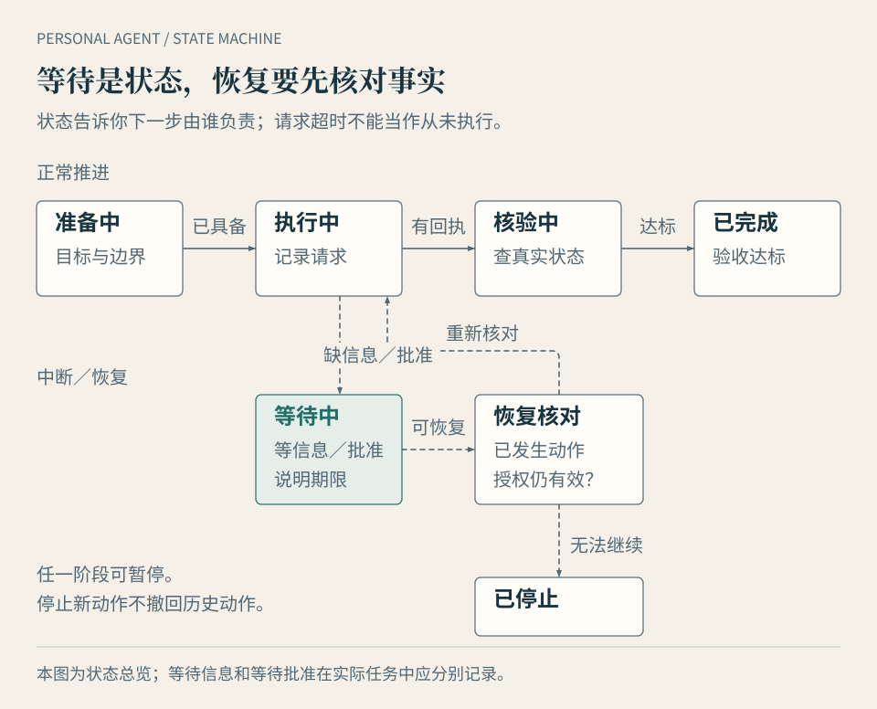

# 第 8 章 · 使用：把一件事交出去，而不是不断补提示词

一次完整委托，要说明结果、背景、资源、边界与验收。代理不需要你替它写出每一步，但需要知道哪些条件不能自行改变，以及什么时候应把决定交回来。

本章回答：**怎样让代理接住一件事，而不让自己变成它的随时值班员？** 先把一次任务做稳，再逐步增加持续性。

## 第一份委托，可以直接这样写

下面的模板适用于第一次试用。把每项填成与你的任务有关的事实；没有必要的项目可以省去，关键边界不能靠默认猜测。

> **目标**：你要替我完成什么，结果用于哪里？
>
> **背景与输入**：哪些事实已经确认，哪些仍需核对？使用哪些文件、日期和版本？
>
> **资源**：允许访问哪些账号、目录、网页或工具？哪些不能访问或外发？
>
> **边界**：哪些动作可以直接做，哪些只能起草，哪些必须先问我？
>
> **预算与时间**：费用上限、工作时间、截止日期与时区；无法估算时先汇报。
>
> **验收**：结果应有什么内容，附什么证据，放到什么位置？
>
> **异常与结束**：遇到登录、信息冲突或审批超时怎么办？何时停止，怎样汇报未完成项？

这份模板的目的，是减少代理和你双方的猜测。写得很长不一定更好；清楚的三条边界，比十段互相冲突的要求有效。

对可直接发送的消息，还应指定收件人、账号与渠道。对文件修改，指定输出目录和是否允许覆盖。对购买，指定金额、币种、对象与确认方式。“预算合理”“发给相关的人”都还不够具体。

## 先跑一次，修正一次，再安排重复

先让代理做一轮低风险任务，核对结果，找出最主要的缺项。把缺项改成可以复用的规则，例如“先核对文档更新时间，旧版不得作为当前稿”，或“只有出现新的可靠来源才更新结论”。

然后再跑一次，确认规则确实生效。需要周期执行时，补触发时间、时区、输入范围、输出位置与失败通知。Grok Bot 的技能与例行任务文档也将可复用方法和触发机制区分开来；产品功能本身不能替你写好验收条件。[技能与例行任务](https://docs.x.ai/grok-bot/skills-routines-and-automations)

若第一次都无法稳定验收，马上安排每天执行，只会把同一种错误复制更多次。持续委托应建立在可用的一次任务上。

## 四个完整案例

以下是教学场景，不是对指定产品的功能或效果承诺。每个案例都说明部署原因、委托边界和验收方式。

### 案例一：跟进行程变化

**为什么考虑云端或混合**：需要跨时间等待邮件，手机上接收通知；若订单只在本机应用中可见，还需合法的本地访问或获准副本。

> 目标：根据会议新时间，为我的既有行程提出可执行的变更方案。
>
> 背景：会议日期以主办方的最新确认邮件为准。原机票和酒店不得自动取消。仅使用提供的订单与指定邮箱中有关本次行程的邮件。
>
> 边界：可以读取相关信息、比较方案、起草询问；发信、变更订单和付款分别请求确认。不能把其他行程或联系人加入任务。
>
> 时间与预算：按北京时间，每天 18 点检查一次回复，周五 16 点前给我最后状态；任何有费用的动作先列出金额和影响，等待确认。
>
> 验收：输出原订单状态、两个可选方案、费用与证据、未回复项。无法确认的内容明确标出，不能写成已完成。

这里的重点不是让它“替我安排最好行程”，而是保持原订单、按时跟进和及时把选择交回来。若主办方消息互相冲突，应报告冲突并请求确认，不自行选择看起来最像的日期。

### 案例二：每周资料简报

**为什么考虑云端托管**：输入主要是公开资料，需要周期检索，文件没有严格本地限制。已有稳定本地运行时的人也可以沿用，不必仅为定时任务换平台。

> 每周五 17 点，整理指定主题本周新发布或有实质更新的资料，最多五项。仅使用公开、可核查来源，保留标题、发布时间、链接和检索日期。
>
> 与上一期比较，区分新增、修正和未变结论。找不到新资料时写明，不用旧新闻填满。宣传演示、厂商文档、媒体报道与独立实测分别标注。
>
> 一页摘要写到指定目录的新文件，不覆盖历史稿，不公开发布。访问需要付费或登录的资料时先停下；重要来源互相冲突时列出问题与出处。

验收时抽查两项最重要的结论，看原始来源是否支持。缺少出处的华丽摘要不应进入长期任务。下一期也要检查去重：形式不同、事实相同的转载，不能算多项新证据。

### 案例三：长期文件项目

**为什么考虑本地或混合**：项目文件可能在本机、团队云盘或私有服务器，部署要跟着实际资源与组织政策决定。不能因为“项目在电脑里”，就默认允许向外部模型发送全文。

> 目标：协助维护这份项目计划，每周汇总版本变化与待办。
>
> 输入：以指定目录内标记为当前版的文件为准；历史目录只作参考。若存在多个当前版，不合并覆盖，先报告冲突。
>
> 边界：允许读取获准文件，在暂存目录生成修改稿与变更摘要；不覆盖原文件，不发送给客户，不修改团队成员的日历。资料外发按项目政策执行。
>
> 验收：列出使用的文件版本、修改建议、依据、待确认责任人与未解决问题。保存本轮输出及完成状态，下一轮从变化继续。

这个任务更容易在“看起来完成”的地方出错。代理找到一份文件不等于找到最新版；把两个相似条目合并，也可能删掉不同人的责任。保留版本、差异与原件，可以降低验收与恢复成本。

### 案例四：本地私有资料与 NAS 归档

**为什么需要本地执行**：输入在私有网络，原资料不能外发，输出还要保留在 NAS。推理、索引、工具和日志都必须按这项要求配置；云端调度是否允许，也要另行核对。

> 在获准的 NAS 输入目录中，读取本次提供的资料副本，按项目与日期生成归档建议及索引。不得访问其他共享目录，不得向外部服务传输原文、片段、标识或运行日志。
>
> 使用已批准的本地模型与工具。先在独立输出目录产生归档方案，不移动或删除原件。文件不完整、重复或格式无法识别时单独列出。
>
> 验收：输出处理数量、未处理清单、索引与抽样核对方法。未经确认不清理原目录；断网不能完成的步骤说明原因，不改用外部服务继续。

若本地模型不足以处理复杂格式，可以缩小为提取已有字段、建立待核查清单，或引入被允许的工具。为了保持“全自动”的表面效果而偷偷放宽外发规则，违背了这个任务的根本条件。

## 任务状态要足够清楚

*图 8-1 · 状态图区分推进、等待与恢复。这里合并展示等待信息和等待批准，实际记录应分开；停止新动作不会撤回历史动作。*

实用的状态可以分为：准备中、执行中、等待信息、等待批准、已完成、已停止。名称不必与产品一致，关键是你能辨认下一步由谁负责。

一条有用的等待通知应说明原因、已完成项、待决定内容，以及不回应的后果。例如：“酒店尚未确认变更，原订单保留；我将等到周五 12 点，再向你报告。没有得到批准，不会取消。”这样你无需打开所有工具重新查一遍。

“任务失败”也应落到步骤。若代理只说“出了问题”，你往往要替它定位故障。让它说明最后确认成功的动作、失败的请求、当前外部状态与可能恢复方式，才能有效接手。

## 暂停和恢复，先防止重复动作

停止代理以后，已经提交的邮件、订单或支付请求可能仍在外部系统处理中。停止新动作，并不会把历史动作撤回来。恢复前，要先读取真实状态。

假设付款请求超时。此时无法根据“没有收到成功提示”就重付。应检查商家订单、支付记录与请求标识；只有确认未执行，才考虑重新提交。发送消息、建立预约、批量修改文件也有同样问题。

程序接口有时支持**幂等（Idempotency）**：用同一个请求标识重试，系统不会重复产生同一业务动作。并非所有界面和工具都有这项保证，所以任务中仍需保存动作记录和回执，不能只靠提示词防重复。

恢复清单可以很短：哪些步骤有确凿完成证据；哪些状态未知；原授权是否仍有效；哪些输入已经变化；下一步是否会产生重复或不可恢复的结果。确认后再继续。

## 什么时候用规则，什么时候自己做

输入固定、条件明确、输出格式稳定的任务，普通脚本或应用自动化可能更省心。每周按固定条件导出表格，不一定需要模型每次重新判断。

代理更适合存在变化、需要理解与跨工具衔接的任务。它可以准备和适应流程，确定部分仍用固定规则执行。把“识别新情况”与“按明确规则动作”组合起来，往往更容易核验。

另一些事情就由你做：只需一分钟的低频操作，重要的人际回应，或必须由你判断的承诺。代理可以准备资料、提供选项，但完整委托不等于把所有决定都移出去。

一个有效委托的标志，是你不用反复补充同一背景，也不必不断提醒下一步。做到这一点以后，下一章讨论如何把这种省心放在明确的授权边界里。

## 本章依据与待验证项

案例、模板与恢复清单均为作者编写。定时任务与审批的产品示例依据 Grok Bot 文档；案例没有默认授予任何品牌尚未验证的能力。实际工具是否提供可靠状态、回执、幂等保证与历史恢复，需按具体接口和任务检查。
