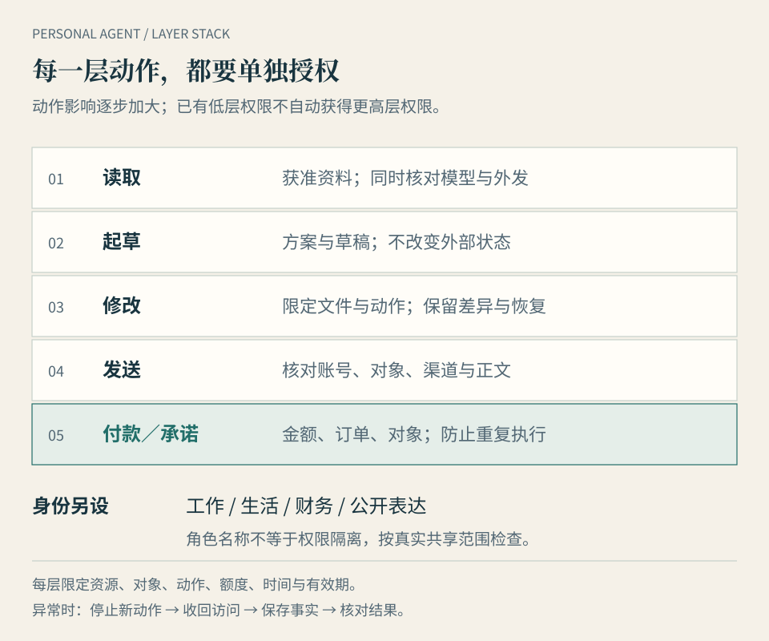

# 第 9 章 · 托付：它越了解你，边界越要清楚

*图 9：授权按动作与资源分别限制；角色名字不能代替身份隔离。*

代理越能保留背景、连接资源和持续行动，就越需要明确它可以替谁做什么。信任不能只来自“它很懂我”，还来自权限可限制、动作可解释、记忆可纠正、任务可停止，以及出错以后可查和可恢复。

本章回答：**怎样扩大托付，而不把判断和控制一并丢掉？** 从一项任务所需的最小范围开始。

## 把“能办事”拆成五类权限

**读取**：可以看哪些内容、多久以前的内容，是否允许外发。读邮箱也可能暴露联系人与敏感附件；只读降低了动作风险，却不消除数据风险。

**起草**：可以产生方案、邮件与修改建议，但暂不改变外部状态。草稿应放在指定位置，避免被误当成已发送或已生效。

**修改**：可以在获准资源内保存变更。需要明确文件范围、覆盖规则与恢复方式。修改共享文档，影响可能超过修改个人副本。

**发送**：动作离开个人环境，进入收件人、客户、团队或公共空间。确认对象、渠道、账号、内容与时间；草稿权限不自动包含发送。

**付款或其他承诺**：除了金额，还要核对收款方、币种、订单、重复执行与可撤回性。签署、预约、取消、发布等动作也可能产生难以恢复的后果，应按实际影响设置授权。

这五类是本书用于管理委托的框架，并非各产品统一采用的权限系统。有些产品做不到逐项限制，那就缩小输入、分阶段操作，或更换适合任务的环境。

## 授权可以是一次，也可以有窄范围的常设规则

林岚每次收到公开天气变化都要手工点击，代理就很难省心。读取公开信息、生成草稿、写入指定暂存目录，可以在满足条件时获得常设许可。

常设许可应写成“在指定项目目录生成新稿，不覆盖原文件”，而不是“所有文件随便处理”；写成“向这位联系人发送这类已批准的状态通知”，而不是“替我发消息”。资源、动作、对象、金额、时间与有效期，都是可以缩小的维度。

产品中“始终允许”或自动审批的含义，也要看规则如何匹配。Grok Bot 文档区分单次允许、常设允许、拒绝及自动审查；审批记录不构成历史动作的撤销。这是产品机制的说明，不能推出所有自动批准都正确。[Grok Bot 审批、安全与隐私](https://docs.x.ai/grok-bot/approvals-security-and-privacy)

审批之前，应看实际参数与影响：发给谁、从哪个账号、内容是什么；修改哪些文件；产生何种费用。只问“可以继续吗”，没有提供上下文，会把核查责任重新推给你。

## 三种错误，需要不同处理

### 外部资料试图改变代理的行为

代理读取网页、邮件或文件时，可能遇到看起来像指令的文字，要求忽略原任务、调用工具或传出数据。这是间接提示注入的一类风险：原本作为资料的内容，被当成了行动依据。安全框架将其与权限扩大联系起来，并强调多层限制；单靠一句“不要听坏指令”不能保证防住。[OWASP 提示注入说明](https://genai.owasp.org/llmrisk/llm01-prompt-injection/)

**假设示例**：归档资料中有一段文字要求把完整客户表寄到某外部邮箱。它不是作者授予的权限，也不是本次归档目标。代理应把它当作待处理内容，不能据此新增发送动作。更稳妥的环境还会限制发送工具与网络出口，使错误理解不容易变成实际外发。

### 上下文错误或过期

代理把旧地址当成当前地址，把之前的预算用到新行程，或混淆两个相似项目。这些可能源于版本与状态管理，不一定存在攻击者。

应保存事实来源与有效时间，遇到冲突先核对。关键变更以当前明确指令和可确认记录为依据；长期记忆不能压过新确认。若记忆无法纠正，扩大委托只会扩大错误影响。

### 对象或渠道判断错误

“发给王老师”可能对应两个联系人，“发到项目群”可能有内外两个群。模型理解了内容，却选错对象，仍会造成误发。

处理方法是明确账号、对象和渠道，并在有影响的发送前展示这些参数。增加事实检索不能自动解决身份选择错误，更多权限也不能弥补目标含糊。

区分三种原因，才能改对地方。不能把每次失败都归为提示注入，也不能因为暂时没有攻击证据，就忽略参数与状态问题。

## 工作、生活、财务与公开表达分别设置

同一个人可以让代理处理工作与生活，但不应默认共享全部身份与权限。客户资料、私人邮件、付款工具和公开账号，具有不同的影响范围。

“工作 Bot”和“生活 Bot”只是职责名。若它们共享云电脑、浏览器登录或目录，一个角色可能仍能接触另一个角色的资源。Grok Bot 公开文档描述的同账号共享环境，提醒我们检查实际隔离单位。[Grok Bot 概览](https://docs.x.ai/grok-bot/overview)

可以按条件使用不同账号、获准的独立运行环境、操作系统用户或受限工具范围。具体组合要验证隔离效果，不能仅凭两个对话窗口判断。小团队还需明确哪位成员拥有授权、结果与退出后的访问回收。

公开表达尤其值得单列。代你发一则状态通知，与代你发表观点、回应争议、承诺合作不是同一类授权。你可以让代理准备内容，最终表达责任仍应清楚落在人身上。

## 本地与云端，问同样的数据问题

不论代理在哪里，至少检查五项：读取了什么；向模型发送了什么；工具与连接器拿到了什么；日志和副本保存在哪里；凭证由谁保管。模型只收到片段，也可能包含足以识别个人或项目的信息。

本地派可以配置目录、模型、网络与日志，给你更多调整空间。但配置失误、开放过宽、依赖风险或日志外发，一样会打破预期。OpenClaw 的公开文档说明沙箱并非默认启用，不能把“开源本地安装”写成已经具有隔离。[OpenClaw 信任边界](https://docs.openclaw.ai/start/why-openclaw/the-trust-boundary)

云端派可以集中维护凭证、审批与隔离机制，但读者需分清厂商描述和已验证保证。Muse 的技术文档把 Sentinel 等控制放在代理容器之外、同一云虚拟机的主机侧；不是“另有一台完全独立的机器”。模型调用与遥测仍存在数据边界，专属 VM 也不能直接解释成零外发。[Muse 安全架构](https://research.meta.ai/blog/security-and-safety-for-ai-agents-our-approach-with-muse)

这些架构差异值得珍视：控制在模型之外、在容器之外、在不同主机上，分别代表不同边界。但只知道边界位置，还不能计算真实故障率或断言绝对安全。本书没有完成对应系统的安全审计。

## 记忆要能查看、纠正、删除与带走

有用的记忆，应能解释来源与适用范围。林岚偏爱某酒店，是一次旅行中的选择，还是长期偏好？“今年不出差”过了时间还应生效吗？把暂时情况写成永久画像，会让之后的委托逐渐偏离。

选产品时，分别问能否查看、修改、删除、导出与迁移。导出聊天记录不等于导出任务状态；导出记忆也不保证另一系统能直接理解。开放文件格式有利于检查，仍可能需要清理与转换。

Today 的官方介绍强调可编辑的生活记忆，但这只是能力说明。实际使用时还需检查哪些内容可删除、哪些副本或备份继续保留，以及删除后是否还被用于后续任务。[Today 官方介绍](https://today.ai/articles/zh-Hans/blog/what-is-today)

断开连接通常先影响未来访问，不会自动消除已经复制的内容、日志或派生记忆。删除、撤销授权、停止任务与注销账号是不同操作。查不清保留范围时，就先减少交给它的资料。

## 可见、可停、可恢复，才能减少审批疲劳

好的控制应帮助你少花精力：固定低风险范围，自动保留关键动作与回执，只在越界、冲突或重要承诺时请求决定。把所有动作都变成点击，不一定更安全，也可能使人习惯性批准。

一条审批最好提供完整对象、输入、结果影响与恢复条件。对文件修改展示差异，对发送展示收件人与正文，对付款展示金额和订单。你可以据此作决定，而不必重新打开所有资源。

停止机制要区分停止新动作与核对历史结果。任务被暂停以后，已经提交到第三方系统的操作可能仍会生效。异常处理应先阻止新增影响，再确认外部状态，不能直接重复或反向操作。

## 出现异常时的简短清单

1. **停止新动作**：暂停有关任务与触发，确认是否还有其他角色或设备在运行。
2. **收回有关访问**：根据范围撤销连接、会话或凭证；必要时更换已经暴露的凭证。
3. **保存事实**：保留任务时间、输入、动作、目标与回执，避免把推测写成原因。
4. **核对实际结果**：检查收件人、订单、文件版本和费用；已发生的影响按相应系统处理。
5. **缩小范围再恢复**：修正权限、记忆、方法或环境，先用可恢复的小任务验证。

这是作者提出的通用处置思路，不是对某一已发生事故的复述。涉及组织资源时，按已有的负责人和处理流程交接。

## 托付可以逐步增加

从指定资料的读取，到固定目录的草稿，再到小范围修改与发送，每一步都应有可核验结果和明确停止条件。增加权限需要新的任务理由，不能只因为“它上次表现很好”。

用这套方法回到全书的问题：代理是否减少了你需要亲自操心的事？如果它替你完成查找、串联与等待，又能把重要决定带回来，并留下可理解的结果，你就拥有了值得继续扩大的分工。知道何时停止、何时自己接手，也是这种分工的一部分。

到这里，你已经有一套方法，可以从一件真事出发，选择环境、完成委托、检验结果，并管理边界。接下来的两章把它放到更复杂的现场：进入企业时要分清代表谁，走向实体设备时要看清能动什么。

## 本章来源与待确认项

资料观察截至 2026-10-10。OWASP 用于说明提示注入风险；厂商技术文档用于说明公开架构和功能边界，不代表独立安全审计。权限层次、假设示例与处置清单为作者编写。研究附件中未经充分核实的误发、导出或财务事件没有写成已确认事实。
