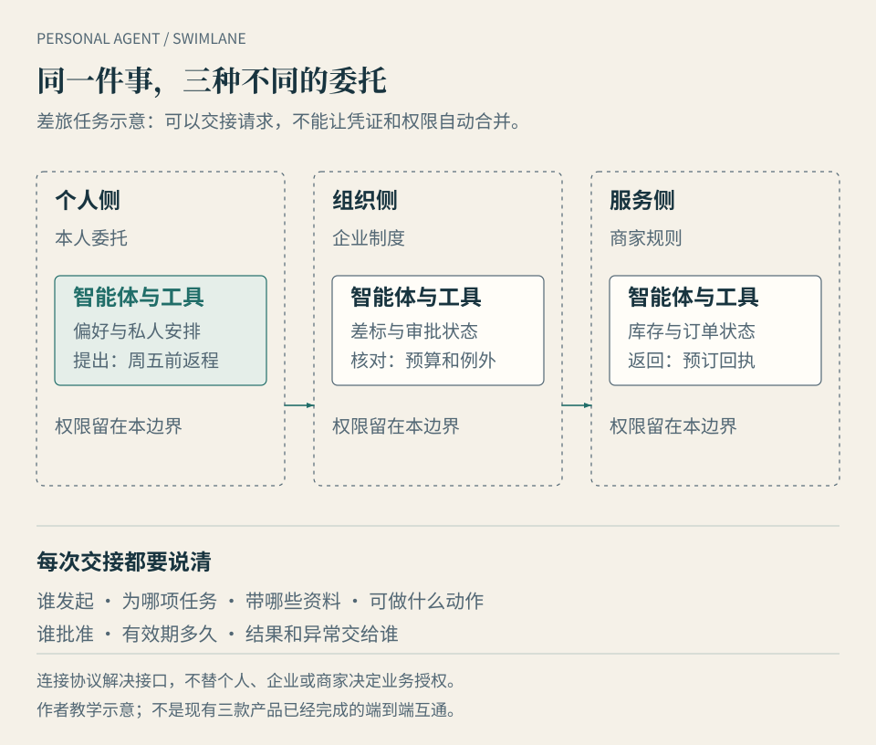

# 第 10 章 · 走进企业：个人智能体怎样与组织共事

*图 10：三种角色围绕同一事务协作，却不共享一张无限通行证。箭头表示有条件的交接，不代表任何产品已完成图示中的端到端流程。*

林岚准备出差，自己的个人智能体知道她偏好靠窗座位，也知道她周五必须回家。公司的差旅系统知道预算、审批人和供应商协议。她问：“下周去上海的行程能安排好吗？”这句话跨过了两种身份：一个为林岚管理私人约束，一个受企业制度约束。若要让它们协作，问题不是把所有日历、邮箱和付款凭证接到同一个聊天窗口，而是让每一步都有明确的委托人、可用资料、可做动作和回执。

**本章的问题：个人智能体进入企业后，怎样与组织的智能体合作，又不混淆权限和责任？** 本章把已经可见的企业工具、仍需验证的商业收益与面向未来的协作方式分开。以下产品案例说明厂商公布的功能和部署方向，不是本书的统一实机测评。

## 先分清四种“替谁办事”

| 角色 | 通常为谁服务 | 典型任务 | 不能直接推出的权力 |
| --- | --- | --- | --- |
| 个人智能体 | 一个具体的人 | 记住偏好、追踪私事、替本人准备请求 | 读取雇主资料、代表公司承诺或付款 |
| 员工工作助手 | 员工在职务范围内 | 查询可访问的知识、准备会议材料和工单 | 继承员工全部可见资料，或绕过审批 |
| 团队／流程智能体 | 经组织指定的团队或流程 | 分类请求、更新限定系统、按规则交接 | 把一次部署扩大成全公司的通用授权 |
| 客户服务智能体 | 商家或机构 | 回答服务问题、提交商家允许的操作 | 代表客户表达购买意愿或替客户同意条款 |

同一个服务可以提供多种角色，但角色不会因为共用模型而合并。比如个人智能体替林岚提出“优先周五返程”，企业差旅智能体检查差标并给出符合制度的选项；最终谁批准超预算、谁付款，应由公司政策和具体授权决定。**个人偏好可以作为请求传入，私人记忆不应自动变成企业可无限使用的资料。**反过来，企业文档也不应因员工使用私人账号而被带出组织。

市场已经在提供不同层级的企业入口。[飞书 aily](https://www.feishu.cn/content/3d5z9ttt)介绍了技能编排、知识处理、效果调优及发布到企业渠道的能力；[Microsoft 365 的管理员指南](https://learn.microsoft.com/microsoft-365/copilot/agent-essentials/m365-agents-admin-guide)列出策略、智能体清单、分配和部署；[ChatGPT Workspace Agents 文档](https://help.openai.com/en/articles/20001143-chatgpt-workspace-agents-for-enterprise-and-business)说明创建、分享、计划运行及管理员控制。这些是企业工作环境正在形成的证据，不说明三个平台的功能、权限模型或完成率相同。腾讯元器的[企业微信发布文档](https://yuanqi.tencent.com/guide/publish-agent-work-wechat)也展示了渠道接入；发布到员工入口仍不等于获得后台业务系统的全部执行权。

## 企业为何不满足于“会回答”

企业采购的往往是一条可验收的工作流程，而不只是一个更聪明的输入框。以 IT 服务台为例，员工报告无法登录，智能体可以先识别设备与账户、查找已批准的排障步骤、收集错误信息，再决定是否生成工单。真正交付要看账号是否恢复、工单是否被正确分派、异常是否有人接手。若只生成一段看起来专业的建议，却没留下可追溯的状态，企业仍需人工从头处理。

能较早落地的通常是**边界清楚、反馈较快、原系统可记录结果**的任务：知识检索与摘要、客服分类、销售资料准备、工单流转、受限字段更新。涉及价格承诺、合同、资金、医疗或生产控制时，验收和授权必须更严格。一个代理能调用工具，只说明有技术路径；调用是否允许、结果是否正确、责任归谁，还要靠组织制度和实际控制。

规模数字也要看口径。[麦肯锡 2025 年调查](https://www.mckinsey.com/our-insights/the-state-of-ai-2025)称，23% 的受访者报告其组织在**至少一个业务职能**扩展智能体系统，另有 39% 开始实验。[2026 年调查](https://www.mckinsey.com/capabilities/quantumblack/our-insights/the-state-of-ai)则称，约两成受访者报告智能体进入**整个组织范围**的扩展阶段；另有 37% 报告 **AI 整体**对组织 EBIT 有正向贡献，这不是智能体单独的利润率。两年所问的扩展范围不同，不能直接相减算增长。企业落地的比较单位应是“一项流程在一定时间内交付多少合格结果”，而不是“创建了多少智能体”。

## 五道边界决定它能不能交付

**身份。**它以员工、组织服务账户，还是客户的代理身份发起请求？企业能否看到明确的拥有者与运行实例？[NIST 2026 年的智能体身份与授权概念文件](https://www.nist.gov/news-events/news/2026/02/new-concept-paper-identity-and-authority-software-agents)把这个问题列为需要标准和实践验证的方向，不能读成现有系统已有统一解法。

**资料。**工单可能需要设备日志，却不需要员工整封邮箱；差旅可能需要审批额度，却不需要私人健康记录。组织内部还要处理“员工原本能搜索到”与“代理可以批量汇总并传播”之间的差别。资料可见、可用和可外发是三项不同许可。

**动作。**查询知识、起草、提交、修改和付款，应分别授权。工作流可以按低风险事项预先批准，高影响动作保留人工确认。OpenAI 的[工作区智能体文档](https://help.openai.com/en/articles/20001143-chatgpt-workspace-agents-for-enterprise-and-business)特别提示：若发布智能体时使用创建者的个人连接，其他使用者可能借用其凭证行动。这是“把个人助手分享给团队”必须先检查的具体风险。

**交接。**跨系统消息至少要说明请求来自谁、为哪个任务、有效范围、当前状态和下一位负责人。MCP 规范提供工具发现与调用接口，[A2A](https://developers.googleblog.com/en/a2a-a-new-era-of-agent-interoperability/)探索智能体间通信；它们不会自行替公司批准预算、替客户同意条款，或裁定一次错误操作的责任。

**记录与撤销。**谁批准了什么，代理实际做了什么，外部系统回了什么，失败时能否暂停并由人接手？权限到期、人员离职或项目结束时，连接也应可撤销。只记录聊天结论，难以回答这些问题。

用差旅故事复盘：个人智能体可带着“周五返程”的偏好提出候选方案；企业差旅智能体在自己的权限内检查政策；审批人决定例外；预订系统返回订单号。每一步都比“AI 帮我订好了”多一些说明，却能让人知道发生了什么。这个流程是作者的教学示意，并非某一家产品已经实现的完整互通。

## 商业落地，算完整任务的净账

企业常见收费可能包含席位、调用量、连接器、部署维护和人工服务；按结果收费则需要先定义结果。客服“发出回复”和“问题解决”、销售“写出邮件”和“有效成交”，相差很远。采购者可以先挑一个低风险、重复发生的流程，约定基线与验收窗口，再记录：

| 指标 | 具体问法 |
| --- | --- |
| 合格结果 | 多少任务按事先标准结束，而非只生成草稿？ |
| 人工负担 | 审批、监督、复核、纠错和接管分别用了多久？ |
| 可恢复性 | 超时或工具失败后，能否从正确状态继续，避免重复提交？ |
| 权限与损失 | 越界请求被拦下多少，误操作如何发现与补救？ |
| 单位经济性 | 订阅、调用、集成、维护和人工成本，摊到每个合格结果是多少？ |

这样也能解释一种表面矛盾：员工觉得助手节省了写作时间，公司却暂时没有看到整体利润改善。节省可能发生在局部，连接、复核和变革成本却由别处承担；也可能尚未修改原流程，只给它多加一层界面。本书不把这一解释当作所有企业的事实，而建议用完整任务数据检验。若复核时间和错误成本吞掉收益，应缩小代理的动作范围，或保留更简单的自动化。

## 个人智能体与企业的下一种关系

值得观察的前瞻，是个人智能体代表用户提出**有范围、有期限、可撤销**的请求，企业智能体在自己的制度内回应。员工换公司时，可带走自己的偏好和私人任务，但不能带走原公司的工单、客户资料与服务凭证；客户换商家时，也不应为了享受服务而交出整个私人记忆。代理之间可以对接，身份和数据依旧分别管理。

交易尤其考验这条边界。[Google AP2](https://cloud.google.com/blog/products/ai-machine-learning/announcing-agents-to-payments-ap2-protocol)提出用意图和付款授权凭据记录代理购物中的委托；它是技术协作方向，不证明所有商家已接入，或争议处理已有统一法律答案。个人智能体若兼任商家推销入口，也应让用户知道它此时替谁说话。相同的透明原则，随后会延伸到眼镜、家庭设备和机器人：当智能体看见或触碰现实世界，权限边界只会更具体。

## 本章来源与观察边界

核查日期：**2026-10-12**。企业产品功能采用官方公告或文档口径；麦肯锡 2025、2026 年数字为不同口径调查中受访者的自报阶段。本章没有统一测试采购、员工隐私政策、跨组织互通或企业 ROI。任务分层、五道边界、差旅示例与指标表为作者分析，详细证据和争议见[本次研究记录](https://github.com/mancbj/personal-agent-book/blob/main/research/enterprise-hardware-sources.md)。
