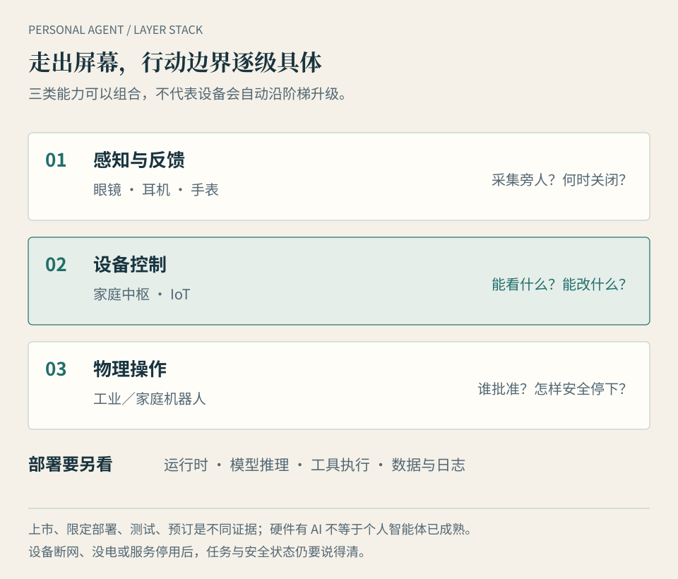

# 第 11 章 · 走出屏幕：眼镜、家居与机器人

*图 11：感知、连接与物理动作是三类能力，不是每台设备必经的升级顺序。图中的边界是作者的分析框架；实际产品按正文逐项核对。*

同一场出差，林岚在工厂车间不用掏手机，就能从眼镜看到设备编号和远程专家的提示。下班回家，她希望家居系统在自己进门时调好灯光。更远的愿望是让机器人把门口的包裹拿进来。它们都发生在屏幕之外，却不是同一种“个人智能体”：前者重在现场信息，第二种是对联网设备下指令，第三种要在有人活动的空间里移动并接触物品。

**本章的问题：硬件为个人智能体增加了什么，又在哪一步把风险从数字世界带进了物理世界？** 本章按“感知与反馈、设备控制、物理操作”看成熟度，不按发布会上的未来画面排列。一个内置 AI 的设备，若不能在用户授权下持续保存必要任务状态、调用工具、核对结果并报告异常，就更适合称为智能入口或单项设备，而不是已经成熟的个人智能体。

## 第一层：更近的眼睛、耳朵和提示

眼镜、耳机、手表能让助手在用户离开电脑时听到请求、获取部分现场线索并迅速反馈。它们的独特价值不是单纯缩小屏幕，而是让“我正在看什么、走到哪里、手上是否空着”成为任务条件。[Meta Ray-Ban Display](https://about.fb.com/news/2025/09/meta-ray-ban-display-ai-glasses-emg-wristband/)已公布眼镜显示与 EMG 腕带交互，并于 2025 年在美国限定线下渠道开售。它证明一种入口可以买到，不证明佩戴者的全部生活事务已能自动办理；具体功能和地区仍按版本检查。

企业一线作业展示了更清楚的价值。[RealWear Navigator 520](https://www.realwear.com/devices/navigator-520)面向现场人员，厂商列出免手持的远程协作、数字工作流和 AI 支持。维修人员若能在设备前看到操作步骤、传给专家实时画面，比往返电脑查询更方便。但“眼镜给出指导”和“眼镜自主维修设备”相差很远；现场安全、知识是否适用、最终操作仍要由有资格的人确认。设备售卖页面也不能证明某一客户的实际节省时间。

可穿戴带来一组容易被低估的约束：摄像头和麦克风会记录旁人；电池、网络和噪声影响持续使用；小界面不适合复杂审批。应问清何时采集、是否提示旁人、谁能查看记录、掉线后保留哪些功能。越是“随时理解我”，越需要明确何时不看、不听、不保存。

## 第二层：让家居与 IoT 成为获准的工具

个人智能体可以通过家庭中枢把设备状态当作输入，把灯、空调、传感器和门锁作为工具。这里至少有四个不同位置：用户发出意图的眼镜或手机，保存任务状态的运行时，做推理的模型，以及真正执行开关动作的设备。它们可以分布在本地和云端，不能仅凭“智能家居”四字推断隐私或离线能力。

[Home Assistant 的本地语音方案](https://www.home-assistant.io/voice_control/voice_remote_local_assistant)提供一个可核对的本地路径：语音识别、意图处理和语音回复可以在家中设备完成。用户若另外接入在线大模型、远程服务或外部自动化，数据路径就会变化；本地语音控制也不能等同于任意复杂任务都能本地完成。第 5 章的本地派在此有实际位置：它靠近不对公网开放的设备与网络，可在授权范围内操作，不必先让整个家庭暴露给远程平台。

互通标准降低接设备的难度，却不负责替家庭作决定。[Matter 1.5](https://csa-iot.org/newsroom/matter-1-5-introduces-cameras-closures-and-enhanced-energy-management-capabilities/)扩展摄像头、门窗类设备与能源管理等支持，说明兼容范围在增加。支持一个标准，不等于某台旧设备已升级、任意品牌均无障碍互通，更不等于代理有权查看摄像头、开锁或调高供暖。**连接、看见、改变状态，应是三种分开的许可。**

一种可用的家庭规则是：低风险的灯光场景允许限定时段自动执行；涉及门锁、炉灶、监控录像或大额能源消耗的动作，需要更具体的条件和确认。条件应能写成“谁在场、哪个设备、什么时间、失败如何恢复”，而不是一句“帮我照看家”。这只是作者的权限设计示意，具体设备能否支持，必须查它的接口与控制能力。

## 第三层：机器人把“行动”变成可碰触的结果

机器人让个人智能体的任务从点按钮走向搬运、整理、清洁与照护。可见进展需要按场景分层：[Figure 公布了 Figure 02 在 BMW 工厂约 11 个月的部署经历](https://www.figure.ai/news/production-at-bmw)，这是厂商报告的限定工业任务；[Google DeepMind 的 Gemini Robotics On-Device](https://deepmind.google/blog/gemini-robotics-on-device-brings-ai-to-local-robotic-devices/)在 2025 年面向选定测试者提供设备端模型与开发工具；[1X NEO](https://www.1x.tech/discover/neo-home-robot)开放家用机器人早期订购并提出交付安排。工厂使用、开发者测试和面向消费者预订，分别证明不同阶段，不能合并成“家庭机器人已经普及”。

本地机器人模型值得注意，因为部分感知和动作判断可贴近设备，减少对往返网络的依赖。但“模型在机器人上”仍不能自动推出整机离线、无需云端训练与运维，或可以安全完成任意家庭任务。第 2 章区分的运行位置、推理位置与工具位置，在机器人身上尤其重要。

数字任务误发一封邮件，可能还能补救；物理任务撞到人、夹到手、打翻热水或错误控制设备，补救空间就小得多。安全要求不应由语言模型临场发挥：限速和活动范围、障碍检测、紧急停止、人工接管、设备权限与故障后的安全状态，都要在执行系统里落实。NIST 对[机器人自主系统测量](https://www.nist.gov/programs-projects/measurement-science-robotics-and-autonomous-systems-program)和[工业运行技术安全](https://csrc.nist.gov/pubs/sp/800/82/r4/ipd)的工作，分别说明物理操作需要验证安全性能、运行技术还有可靠性与安全约束；后者在本次核查时为**公开征求意见稿**，不能当成已实施的机器人法规。

## 三种路线怎样组合，而不是互相取代

云端平台能提供跨设备状态、复杂模型和维护服务；本地运行时能靠近传感器、私有网络和实际执行器。现实中的组合可能是眼镜获取请求、手机承载账号、家庭中枢执行设备命令、云端模型处理复杂推理。每跨一道边界，都应知道哪些声音、图像、位置与指令被发送，哪一端保留记录，网络断开后还能做什么。

这种组合并不要求所有硬件都归属一家厂商。更值得观察的是任务能否交接：眼镜看到故障码后，手机上的个人智能体能否保存待办；企业系统能否只收到必要的设备信息；现场人员是否能在确认后继续，而不是重新解释一遍。前章的身份边界在这里遇到物理边界：个人智能体可以协助员工，但厂房的机器、客户的摄像头和家庭的门锁，各有独立所有者与授权规则。

硬件还有软件服务寿命。Humane 的[消费者通知](https://support.humane.com/hc/en-us/articles/34374173951373-Important-Update-for-Consumer-Ai-Pin-Customers)写明 Ai Pin 的云端服务在 2025 年 2 月停止后，语音交互与 AI 回答等依赖云的功能不可用。它不能证明所有云端硬件都会失败，却提醒读者购买时检查：核心功能能否离线使用、数据能否导出、服务停用后设备还有什么价值、由谁提供更新与维修。对戴在身上或装在家里的产品，这些不是附带条款。

## 用一次真实任务判断硬件价值

选择一个连续四周会重复的任务，再看设备是否减少了整个任务的负担：

| 记录什么 | 可观察的问题 |
| --- | --- |
| 任务完成 | 设备有没有帮你做成事，还是只让提问更方便？ |
| 人的负担 | 佩戴、充电、唤醒、纠错和审批是否抵消便利？ |
| 数据与旁人 | 拍摄和录音如何提示、关闭、保存与删除？ |
| 网络与故障 | 断网、没电、传感器误判时能否安全停下？ |
| 长期成本 | 设备、订阅、耗材、维修和服务终止各有什么代价？ |

如果只需定时开灯，可靠的固定规则可能比会聊天的代理更好。如果任务需要观察变化、查找信息、取得许可并在失败后跟进，个人智能体才更有发挥空间。它走出屏幕以后，值得托付的标准没有降低：**知道自己代表谁、能动什么、何时停下，并让人看得见结果。**

## 本章来源与观察边界

核查日期：**2026-10-12**。设备可售、部署、测试与预订按各来源分开；Figure 的工厂成绩和各厂商的功能描述仍属其公开口径。本书没有实测眼镜、家庭网关或机器人，也没有给设备作安全认证。三层能力、授权规则和四周观察表是作者分析，详细证据和未核实项见[本次研究记录](https://github.com/mancbj/personal-agent-book/blob/main/research/enterprise-hardware-sources.md)。
