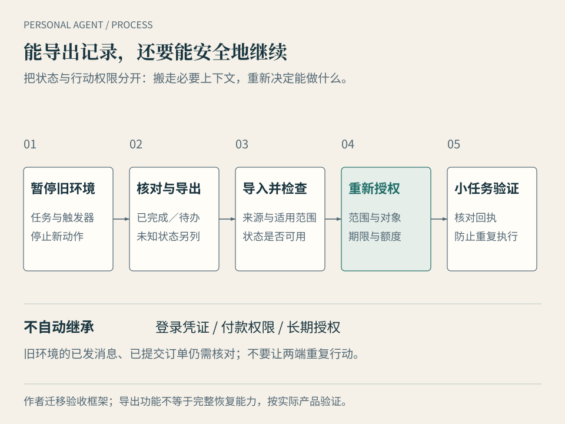

# 第 12 章 · 当代理成为入口，谁掌握你的数字生活

林岚最初只是想处理一次航班变更。如果代理后来记得她偏好的航班时段、能接受的转机时间、常住酒店和家人的安排，她当然可以少解释许多事情。

问题随之变得更大。下次她要换一个服务，这些记忆能否带走？代理优先推荐的酒店，是因为适合她，还是因为更容易成交？如果它已经发出了消息、提交了订单，谁能停止后续动作，谁处理争议？

**本章的问题：便利之外，我应该保留什么选择权？** 前一章观察代理能否办好事，这一章观察用户能否继续决定事情怎样办。两者可以同时成立，也需要分别验收。

## 长期记忆既是服务能力，也是迁移成本

个人智能体的价值，可能越来越多地来自长期关系。它知道你说过什么、改过什么，以及哪些偏好只在某些情境适用。有用的记忆不只是“林岚喜欢靠窗”，还包括这条偏好来自哪里、何时确认、遇到哪种条件应让位。

这也会带来迁移成本。新服务即使有同样强的模型，也不一定知道旧服务里哪些任务仍在等待、哪些偏好已经过时、哪个订单需要继续跟进。若必须从头解释，用户会更难离开。

这种成本是作者对工作结构的分析，不是对所有平台已经限制导出的指控。Today 描述可编辑的生活记忆；dots 描述持续学习用户的工作方式。公开功能定位支持“记忆参与服务”这一点，是否能完整迁移，仍应逐项验证。[Today 官方介绍](https://today.ai/articles/zh-Hans/blog/what-is-today)、[dots 公告](https://openai.com/index/introducing-dots/)

因此，询问“能否导出数据”时，要继续问导出的是什么。聊天文本、事实与偏好、进行中的任务、工具配置和授权记录，是不同的东西。聊天记录可阅读，不表示新代理知道今晚应该继续等哪个回复。

一个可用的迁移过程，至少要让你识别这些状态。旧环境要说明已完成与待办的区别；新环境要经过你的确认再启动低风险工作。登录凭证、付款权限和长期授权不应因“导入成功”就自动原样生效。迁移要转移必要上下文，也要给用户重新决定权限的机会。

*图 12-1 · 迁移流程把状态与行动权限分开。能读到导出的文件，还要验证新环境能否安全地接回任务。*

## 控制权要落实到几个可以执行的动作

“数据属于你”是一句方向性表达。实际控制要看你能否查看、纠正、限制、暂停、撤销、导出和恢复。每个动作都应有明确对象。

| 我想保留的选择 | 应能完成的动作 | 容易遗漏的区别 |
| --- | --- | --- |
| 改正它对我的理解 | 查看并修正偏好、事实及其适用范围 | 删除一段聊天，不一定删除衍生记忆 |
| 缩小它能接触的资料 | 限定账号、目录与工具，检查实际数据流 | 本地运行，不一定本地推理或零外发 |
| 停止持续工作 | 暂停任务与触发器，确认没有新的调用 | 关闭聊天窗口，不一定停止后台任务 |
| 撤回行动权限 | 撤销连接、令牌与常驻授权，确认生效 | 停止未来动作，不会自动撤回已发消息 |
| 换一种运行方式 | 导出所需状态，在另一环境恢复小任务 | 有文件，不等于有可用的恢复路径 |
| 知道出了什么问题 | 查阅行动、授权、费用与错误记录 | 自然语言总结，不一定是完整审计记录 |

这张表是选型与使用的问题清单，不能替代具体产品的操作说明。第 9 章的最小权限在这里延伸为长期管理：任务开始时知道交出了什么，结束或迁移时知道怎样收回来。

尤其要区分暂停与补救。停止后续调用，可能阻止新的订单，却无法取消已经成立的订单；撤销邮箱连接，不能收回收件人已经读到的内容。后者需要相应服务的撤销、退款或纠错流程，有时只能人工处理。

## 本地、自托管、平台托管与开放协议，各保留什么

云端平台可以把运行、更新、跨设备入口与支持服务一起提供。它的便利建立在平台管理环境的条件上；用户仍需知道自己能看到什么日志、设置什么权限，以及停用后哪些数据与任务会保留。

本地运行时靠近自己的设备、文件与私有网络。你可以保留更多配置与资源访问的决定权，也要承担备份、更新、故障处理和部分安全工作。自托管如果部署在云服务器上，属于自主管理的远程环境；不能据“自己装的”就推断数据没有离开本机。

开放协议解决另一层问题：让不同软件按共同接口交换请求、工具或状态。它有助于减少某些重复适配，仍不能保证厂商提供同样的功能、允许导出所有状态，或执行完全一致的权限规则。MCP 的工具接口和本书前两篇讨论的授权管理，是不同层面的事情。[MCP 工具规范](https://modelcontextprotocol.io/specification/2025-06-18/server/tools)

本地派在这里仍有独立地位。涉及不公开的家庭设备、内网应用、私有文件和严格不外发的资料时，用户需要在设备与网络边界内保留执行权。纯云端服务要接手，必须增加合适的连接或本地组件；这样形成的混合环境，也必须说明哪部分资料传给了远程模型。

反过来，拥有本机文件和开源代码，不代表已有简单的控制界面，或已经具备安全隔离。本书前两篇核对的 OpenClaw 信任边界明确要求看配置、工具和隔离条件。用户应把“我有能力改”与“我已经正确配置并持续维护”分开。[OpenClaw 信任边界](https://docs.openclaw.ai/start/why-openclaw/the-trust-boundary)

**本书的取舍建议**是按资源决定控制放在哪里，按维护能力决定由谁运营。一部分私有处理留在本地，一部分持续服务交给托管环境，也可以是一种有明确边界的选择。平台服务与用户可控环境之间的竞争，会取决于便利、能力、成本和迁移条件；本书不预先宣布某一方必然取代另一方。

## 它替谁比较，又替谁促成交易

当代理推荐酒店、购买商品或选择服务，它掌握的不只是操作入口，还包括候选项的筛选与排序。用户看到一个简洁结论，很难知道哪些方案从未进入比较。

订阅、佣金和广告，都可能成为服务的收入来源。它们产生的激励不同：订阅服务也可能希望用户升级，佣金可能鼓励成交或选择某些商家，广告则直接购买注意力。收入方式本身不能证明某次推荐有偏见；它值得被说明，并与实际推荐机制一起观察。

一个已公开的例子是 OpenAI 在 2026 年 9 月宣布测试 **Sponsored Agents**：用户点击广告以后，可以进入有明确标识的商家赞助代理对话，测试范围是美国的部分广告主。官方同时区分这种对话与 ChatGPT 的独立回答。另一个帮助页面表示购物搜索的商品结果与广告分开。这些是厂商的规则与产品说明，本书没有独立审计它们的实际执行，也不能套用到 dots 或所有个人智能体。[广告与赞助代理公告](https://openai.com/index/reimagining-advertising-with-ai/)、[购物搜索说明](https://help.openai.com/en/articles/11128490-shopping-with-chatgpt-search)

这个区别对林岚很实际。她让自己的代理比较酒店，是希望它按自己的预算、地点和退款条件工作；商家的销售代理则帮助她理解该商家的服务。两个角色都可以有用，但进入后一种角色时，身份应清楚，新的资料共享与付款权限也不应含糊带入。

用户可以保留三个要求：说明比较标准；在存在商业合作、佣金或赞助时作适用的披露；允许按同一条件查看其他可用候选。代理若只能访问少数合作商家，也应说明覆盖范围，不能把局部比较写成全市场最优。

对于“它站在我这一边”，本书给出的判断依据是具体行为：能解释排序，接受你的约束，区分买方代理与商家代理，并允许你拒绝推荐和改变入口。亲切语气与长期记忆，都不能单独完成这项证明。

## 有邮箱、电话和钱包，不等于有独立法律人格

产品可以为代理提供专用邮箱、电话号码、支付工具或运行电脑。这些资源便于收发信息、维持登录与执行交易，却不能自动决定谁是合同当事人、谁有权授权、谁承担损失。

在**中国大陆的一般民事规则**中，《民法典》第二条以自然人、法人和非法人组织为民事主体；第一百六十二条讨论代理权限内、以被代理人名义实施行为的效力。它们提供的是民事主体与代理关系的基本框架，不能仅因软件产品叫作“Agent”，就直接认定每次自动操作属于法律上的同一种代理关系。[《民法典》政府公开全文](https://tjca.miit.gov.cn/zwgk/zcwj/flfg/art/2020/art_20cf1a2e1b854924b5caa744c8045d1f.html)

第一百七十一条与第一百七十二条也分别涉及无权代理、追认及相对人有理由相信有代理权等条件。它们提醒我们，内部设置的权限与外部交易效力不能简单画等号。本章只引用一般框架，不据此判断具体 AI 交易的效力或赔偿结论。

实际发生争议时，可能需要分别核对用户指令、产品承诺、操作记录、网站规则、付款安排和适用法律。用户授权了哪项操作、系统是否超出范围、商家看到什么信息、平台是否提供了约定的保障，都是不同问题。“都是用户的责任”和“都是平台的责任”都超出了本书能够支持的结论。

跨境服务还有不同地区法律、合同条款与争议解决安排。制度会继续面对持续授权、自动交易和证据留存等问题；这不表示现在没有规则，也不表示已有一套全球统一的个人智能体责任制度。涉及真实争议时，需要结合事实寻求相应司法辖区的专业判断。

对于日常使用，能够立即改善的部分是留下证据：任务目标、额度与限制、确认时点、执行结果，以及负责处理问题的服务入口。前一章提到的 AP2 试图记录交易授权链，但技术记录仍需与合同、机构流程和法律衔接，协议不能自己裁定责任。[Google AP2 公告](https://cloud.google.com/blog/products/ai-machine-learning/announcing-agents-to-payments-ap2-protocol)

## 回到林岚：理想的进步可以很具体

再回到全书开头的行程变更。这一次，我们能写出一份更清楚的委托：

> 核对已有航班和酒店订单，列出可行调整方案；按我确认的渠道等待客服回复。可以在授权范围内收集资料和准备草稿，对外发送、改签、取消或付款前需要我确认。说明每个方案的费用、退款条件、截止时间和信息来源。遇到登录失败、条件变化或授权不足时暂停相关动作，并告诉我需要决定什么。

如果后续适合扩大授权，林岚可以为某一类低风险动作单独设定长期规则，写明对象、额度、期限和例外。那是下一次清楚的授权，不应从“上次你做得不错”自动推导出来。

代理的理想交付，也应围绕事情本身：哪些条件已核实，谁已经回复，哪些方案仍可用，哪项决定等待林岚，以及接下来会发生什么。她不必知道每次模型调用，却应能查看支撑关键决定的记录。

在这项分工中，本地与云端各有位置。本机订单文件或受控网络资料可以留在必要的本地边界内；持续等待与跨设备通知可以由满足条件的托管服务承担。选择完全本地、完全云端或混合，要根据她的资料、连接和维护条件，而不是品牌阵营。

任务结束以后，还有最后几步：关闭不再需要的触发器，撤回临时权限，保存应留的结果，修正错误记忆。将来更换服务时，能分清已完成事项和待办，也不会让两个环境同时重复操作。

这些细节组合起来，就是“值得托付”的实际含义：它在你同意的范围内接手工作，让你知道进展，在关键时点交回决定，并保留停止和更换的路径。

全书从一次变化开始，到这里仍围绕同一个问题。个人智能体能否减少你必须亲自承担的交接与等待，同时让授权、结果和控制更清楚？今天可以从一项小任务开始验证，未来也继续用实际记录回答。

## 本章来源与待确认项

核查日期：**2026-10-10**。记忆的迁移成本、控制动作清单、商业激励分析和林岚的委托示例是作者分析与教学情景，没有作为产品实测或法律个案。

- 记忆与持续关系：[Today 官方介绍](https://today.ai/articles/zh-Hans/blog/what-is-today)、[dots 公告](https://openai.com/index/introducing-dots/)。完整导出、恢复和停用后的保留规则需按产品另查。
- 运行环境与控制：[OpenClaw 信任边界](https://docs.openclaw.ai/start/why-openclaw/the-trust-boundary)、[MCP 工具规范](https://modelcontextprotocol.io/specification/2025-06-18/server/tools)。没有把开源或协议等同于安全与迁移保证。
- 商业角色：[OpenAI 2026-09-16 公告](https://openai.com/index/reimagining-advertising-with-ai/)、[购物搜索帮助页面](https://help.openai.com/en/articles/11128490-shopping-with-chatgpt-search)。厂商表示赞助对话、独立回答和商品结果有区分，本书没有作独立机制审计。
- 法律范围：[《民法典》政府公开全文](https://tjca.miit.gov.cn/zwgk/zcwj/flfg/art/2020/art_20cf1a2e1b854924b5caa744c8045d1f.html)，采用第二条及第一百六十二、一百七十一、一百七十二条的一般框架；不作具体交易效力判断或全球责任归纳。
- 交易证据：[AP2 公告](https://cloud.google.com/blog/products/ai-machine-learning/announcing-agents-to-payments-ap2-protocol)。技术授权记录与法律责任分开。

本书十二章正文到此完成初稿。后面的附录提供术语、产品快照、可复用工作表、自托管路径及争议索引；全书保留来源记录与更新日期，便于继续审阅和修订。
