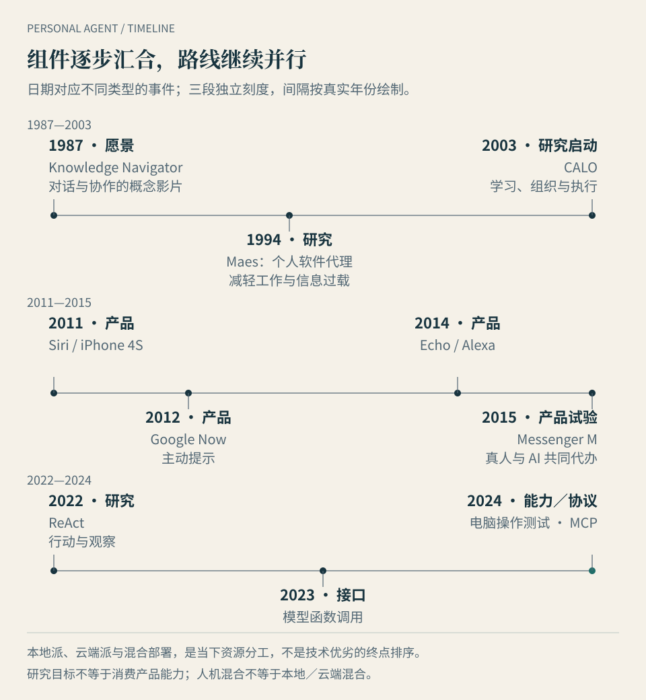

# 第 12 章 · 从数字助理到持续代理：一条并不直线的演进路

*图 12：三段分别标出年份范围，并按真实时间间隔放置精选节点。段间不连续，不同事件也不是一条直接因果链；本地、云端与混合是当下并行的部署路线。*

林岚收到行程变更通知，希望有人检查订单、等待答复、调整方案，再把关键决定带回来。这种愿望并不新。过去几十年，计算机已经逐步学会听懂请求、提示变化、查询信息和操作工具。新的难题，是让这些能力在同一项委托中持续配合。

**本章的问题：今天的进步来自哪里，旧问题又留下了什么？** 我们只回顾能帮助理解当下的节点。这里的时间顺序不表示后一种产品全面替代前一种，也不说明它们都源于同一个项目。

## 起点不同，是因为大家在讲不同的历史

输入研究有的从 1987 年的愿景讲起，有的从 1994 年的软件代理研究开始，有的把 2011 年语音助手普及作为开端。还有观点把近期常驻产品的集中发布称为新品类的诞生。

这些说法可以分别回答问题：人们何时描绘过这种分工，研究者何时把它变成课题，消费者何时获得日常入口，持续代理何时以新的产品组合出现。把四个问题压成一个日期，容易误读。

本书据此区分**愿景、研究、能力发布、产品开放**。概念影片能说明期待，不能证明当年已经可用；论文能展示方法与实验，不能直接代表大众产品；公开测试也不等于所有人都能购买。用这一口径看历史，既能看见积累，也能保留真正的新变化。

## 1987 与 1994：先提出分工，再研究怎样减轻负担

1987 年，Apple 的 **Knowledge Navigator** 概念影片描绘了人与数字助手合作的场景。它把对话、资料、网络协作等放进连贯的使用情境。参与制作的 Hugh Dubberly 后来说明，这是一种把已有想法组合起来的未来表达，并非当时已完成的系统。[制作参与者回顾](https://www.dubberly.com/articles/the-making-of-knowledge-navigator.html)、[计算机历史博物馆的年份与影片说明](https://computerhistory.org/blog/yesterdays-tomorrows-the-origins-of-the-tablet/)

值得留下的是它描绘的分工：人表达目的，计算机帮助组织相关资源。今天的代理演示仍常采用同一种叙事，只是能够实际执行的环节更多了。判断进步时，应看哪些动作已经落到真实系统，哪些仍由剪辑、预设条件或人来补齐。

1994 年，MIT Media Lab 的 Pattie Maes 在《Communications of the ACM》发表 **《Agents that Reduce Work and Information Overload》**。题目就把重点放在减轻工作与信息过载上；论文摘要讨论个性化协助，以及从用户互动中学习。它提供了一条早于语音助手和大模型的研究线索。[MIT 研究组出版目录](https://agents.media.mit.edu/publications.html)、[论文原始出版记录](https://doi.org/10.1145/176789.176792)

从这个角度回看，“它是否记得我的偏好”“我愿意让它代做多少事情”，并不是近期才出现的问题。今天的记忆、授权与净省心讨论，仍在处理人和软件如何分工。不同之处在于，可以连接的资源、模型能力和工程条件发生了变化。

## 2003—2011：研究系统走向手机入口

2003 年起，SRI 牵头参与 DARPA 的 PAL 计划，开展 **CALO（Cognitive Assistant that Learns and Organizes）** 研究。公开回顾把推理、从经验学习、执行指令、解释行动和处理意外列入目标。它研究的已经不只是回答问题，而是怎样在共同工作中提供帮助。[SRI 的 CALO 历史](https://www.sri.com/hoi/artificial-intelligence-calo/)

SRI 随后在 2007 年孵化 Siri，Apple 在 2010 年收购它。2011 年 10 月，Siri 作为 iPhone 4S 的集成功能公布，帮助用户用自然语言处理消息、提醒、查询等事项。这是一个具体产品节点，不是所有个人智能体思想的起点。[SRI 回顾](https://www.sri.com/hoi/artificial-intelligence-calo/)、[2011 年 Apple 公告](https://www.apple.com/newsroom/2011/10/04Apple-Launches-iPhone-4S-iOS-5-iCloud/)

手机提供了明确的入口与一部分现成资源：联系人、位置、日历和用户随身携带的设备。把自然语言接到这些功能上，可以减少找菜单、打开应用和输入参数的负担。

但研究成果进入消费产品，不表示研究目标整套兑现。就任务结构而言，设置一个提醒通常有明确输入与触发条件；处理整次行程变更，则涉及多个系统、等待与例外。这是两种不同难度的委托。入口变方便以后，跨步骤交接仍可能由人负责。

这段历史也提醒我们，产品收敛到有限功能，可以是一种合理取舍。一个有边界、可重复完成的动作，依然有价值；不必把所有较窄的助手都写成失败者。

## 2012—2015：主动提示、随时可用与真人代办

### Google Now：知道何时把信息带过来

2012 年，Google Now 随 Android 4.1 的发布进入公众视野。Google 后续官方介绍回顾了这一上线时间，并展示航班、登机牌、出发提醒等卡片，强调在用户开口前提供相关信息。[Android 4.1 发布记录](https://android-developers.googleblog.com/2012/06/introducing-android-41-jelly-bean.html)、[Google Now 官方回顾](https://android.googleblog.com/2013/02/new-google-now-more-of-information-you.html)

它提示了一种重要分工：变化本身也可以触发帮助，用户不必每次重新提问。不过，提醒林岚航班有变化，与修改酒店订单之间还隔着行动与授权。相关信息送到面前，只解决了持续任务的一部分。

### Echo 与 Alexa：让助手容易被找到

Amazon 在 2014 年 11 月推出 Echo，先采用邀请方式；2015 年 6 月宣布扩大销售。它把语音助手放在家庭环境中，提供随时可唤醒的入口。Amazon 同期明确把 Alexa 描述为云端语音服务。[2015 年销售公告及对首发的回顾](https://press.aboutamazon.com/2015/6/amazon-echo-now-available-to-all-customers)、[Alexa Voice Service 公告](https://press.aboutamazon.com/2015/6/amazon-opens-alexa-voice-service-to-third-party-hardware-makers)

这里有两个今天仍容易混淆的区别。设备放在家里，不代表推理与服务都在本地；设备持续等待唤醒，也不等于一个任务正在持续推进。前者说明入口的位置，后者才涉及任务状态与职责。

因此，评价常驻产品时，可以继续问第 6 章的问题：它现在等什么，已经完成什么，下一步由谁负责？服务器一直开着，不能代替这些答案。

### M：聊天委托背后，谁在真正做事

2015 年，Facebook 在 Messenger 中试验 **M**。当年的采访报道描述了少量用户的测试，以及真人与 AI 共同提供代办；Facebook 在 2017 年的官方回顾也确认，早期试验由人参与完成请求，后来推出的 M Suggestions 则提供自动化建议。[2015 年原始采访报道](https://www.wired.com/2015/08/facebook-launches-m-new-kind-virtual-assistant/)、[Facebook 官方回顾](https://about.fb.com/news/2017/04/m-now-offers-suggestions-to-make-your-messenger-experience-more-useful-seamless-and-delightful/)

它提前展示了“向消息里的一个对象交代事务”的产品形态，却不能证明当时软件已经能独立处理开放任务。这里的**人机混合**，与本书前两篇的**本地、云端混合部署**也不是同一个维度。

基于这种服务结构，可以提出一个经济问题：如果扩大服务仍需要增加大量人工处理，成本就不能仅按复制软件理解。这是作者分析，不是对 M 内部成本或经营原因的还原。历史留下的判断方法是：既要看用户得到了什么，也要看结果由谁、在什么条件下完成。

## 2022—2024：语言理解开始接进执行循环

大语言模型为理解多样请求、组织信息与选择下一步提供了新的基础。它们接上工具以后，系统可以根据外部反馈继续工作。这里选取几个公开节点，不声称行动循环或软件自动化由它们首次发明。

2022 年 10 月公开的 **ReAct** 论文研究语言模型交替进行推理与行动：用行动取得新信息，再据观察更新计划。它提供了理解第 6 章工作循环的一个技术入口。论文实验是在指定任务和环境下进行的，不能据此推导开放生活事务的普遍成功率。[ReAct 原始论文与提交记录](https://arxiv.org/abs/2210.03629)

2023 年 6 月，OpenAI 公布函数调用能力，让开发者更容易取得符合接口结构的调用信息，再由应用执行对应工具。语言请求与工具动作之间因此多了一种工程连接方式；模型输出调用参数，仍不等于动作已生效。该公告同时提到不可信工具输出的风险与有现实影响动作的确认需求。[OpenAI 函数调用公告](https://openai.com/index/function-calling-and-other-api-updates/)

2024 年 10 月，Anthropic 公开测试通过屏幕、鼠标和键盘使用电脑的能力，也明确说明其尚属实验、可能出错。同年 11 月发布 MCP，尝试减少 AI 与数据、工具之间各自接入的差异。这是两类不同组件：一个帮助操作界面，一个帮助建立连接。[电脑操作公开测试公告](https://www.anthropic.com/news/3-5-models-and-computer-use)、[MCP 发布公告](https://www.anthropic.com/news/model-context-protocol)

有了这些组件，代理可以尝试接住未被逐条写入规则的任务，也仍会遇到界面变化、登录、状态丢失、权限与验收的问题。理解更灵活，动作覆盖更广，是进步；长期稳定交付还需要运行时、恢复机制与具体工具的配合。

## 本地与云端，是并行组合的路径

语言、工具、记忆与持续运行可以在不同环境中组合。平台云端倾向于把环境、连接与运维做成服务；开放运行时允许用户自己决定模型、工具、状态和部署。两者还会相交：例如，前两篇已经核对的 LightVela 在云端托管 Hermes。[LightVela 官方文档](https://lightvela.com/docs)

本地派也可以持续运行在自己的常开设备或服务器中，提供本机软件、内网与硬件资源的入口。是否能够长期稳定运行，要看供电、网络、进程、工具与恢复配置。云端服务若通过本地组件接入这些资源，就形成另一种混合方案。

输入素材中，博主的“四代”分类可以帮助描述某种使用体验的变化，其他研究则强调持续性、控制权或云电脑。把这些解释带到历史里，需要保留反例：较早的语音设备已经连接云服务；今天的开放运行时仍可以部署在云端；本地任务也不会因常驻平台出现而失去价值。

所以，时间图把本地、云端画成并行分支。分支表示当下可选择的部署与生态组合，不是经过逐个项目考证的直接祖先关系。本书也不采用附件中尚未独立核实的 OpenClaw、Hermes 首发月份来填满年表。

## 三个旧问题，仍是今天的验收题

**提醒不等于执行。** 有用信息到达以后，谁负责把它落实到订单、文件和安排？Google Now 的历史让这条边界容易理解。

**常开不等于负责。** 入口和计算环境持续可用，还要有任务状态、触发、异常处理与完成证据。Echo 的入口价值不能自动推导为开放任务的持续履约能力。

**能展示结果，不等于能稳定交付。** 概念影片、研究实验、真人参与的试验与公开产品，是不同证据。评估今天的演示，也要看输入、权限、人工介入和重复任务表现。

把林岚的行程放回这些节点，就能看出今天真正需要凑齐的部分：听懂目的，取得相关资源，依据变化行动，保留状态，知道何时暂停，并用实际结果接受验收。任何一项都重要，也没有哪一项能单独代表整个个人智能体。

这段简短历史没有替未来定下唯一方向。它让我们在期待新产品时，多问几句可验证的问题：这次补上了哪个环节，剩下哪些工作仍由人承担？后续展望也应从这些问题出发。

## 本章来源与事实边界

历史资料核查截至 2026-10-10。旧公告用于确认事件与当时阶段，不描述这些产品今天的完整能力；研究目标与实验结论分别处理。M 仅按原始采访和官方回顾说明真人参与，没有推断内部经营原因。Maes 论文的出版记录及可检索摘要已核对，全文抓取受限，未对其所有原型与实验作详细复述。来源与分歧处理见[第三篇来源记录](https://github.com/mancbj/personal-agent-book/blob/main/research/part3-sources.md)。
