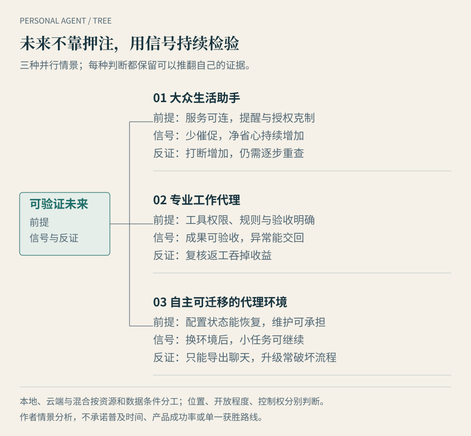

# 第 13 章 · 未来几年，哪些变化最值得观察

*图 13：三种可能并存的形态。前提与反证是作者的观察框架，不是厂商路线图或必然发生的阶段。*

下一次产品发布，也许会让我们看见更自然的对话、更快的电脑操作，或者更丰富的记忆。但林岚关心的进步更具体：航班变化以后，她能否少打开几个应用，少追问一次进度，并在需要决定时收到清楚的选项。

**本章的问题：怎样判断趋势，而不只听宏大预言？** 我们不为未来设定统一到来的年份，而是提出条件性情景：如果哪些事情变得可靠，什么形态会更有吸引力；如果哪些问题持续出现，就应修改判断。

## 三种形态可能并存

下面三种形态按用户委托的重心划分。一项产品可以同时靠近几种形态，同一个人也可能分别使用它们。

### 情景一：大众生活助手，接手反复跟进

它处理日程、旅行、家庭采购、个人资料与消息，把“有变化时告诉我”“等回复以后接着做”变成日常分工。优势来自低门槛、跨设备和持续在线，任务本身未必很复杂。

**成立前提**是常用服务可连接，提醒足够克制，低风险动作能稳定完成，重要决定有简洁的确认方式。用户还要觉得长期授权值得；连接邮箱以后天天处理误报，不能算省心。

**支持线索**是今天已有产品围绕持续环境、主动研究和生活记忆设计功能。例如 dots 官方说明其后台主动研究使用只读工具，而用户委托的工作另有行动边界；Today 的公开介绍把生活记忆与日程跟进放在核心。这说明厂商正在尝试这类分工，不能据此推导大众留存率或现实成功率。[dots 公告](https://openai.com/index/introducing-dots/)、[Today 官方介绍](https://today.ai/articles/zh-Hans/blog/what-is-today)

**应观察**同类任务连续几周是否仍要重新解释，提醒是否真正需要，等待中的任务会不会被忘记。**会削弱判断的信号**是用户持续催促、主动消息增加打断，或者任务做完后仍要人逐步重查。此时，更少但更可靠的自动化可能更合适。

### 情景二：专业工作代理，围绕成果负责

它聚焦一类工作，例如整理研究资料、维护项目记录、编写并验证代码，或准备符合组织流程的文件。任务的专业规则与验收标准，比“知道用户所有事情”更重要。

**成立前提**是输入、工具权限与交付标准可以说明，工作过程可追溯，异常能交回负责人。专业领域如果连“完成”都没有共同定义，按结果委托就容易变成争议。

**支持线索**是前两篇已见到的工具调用、持久状态、专业执行工具和审批机制，可以组合成限定范围的工作流程。MCP 的工具规范提供发现与调用工具的接口；它没有证明工具结果正确，也没有替组织定义谁可以签字。[MCP 工具规范，2025-06-18 版](https://modelcontextprotocol.io/specification/2025-06-18/server/tools)

**应观察**交付能否被工作系统验收，错误在哪一步被发现，人工复核占用多少时间。**会削弱判断的信号**是复核与返工吞掉全部收益，或者跨部门权限始终无法打通。这样的代理仍可能是好用的局部工具，但不能因此宣布整个岗位已被接管。

### 情景三：自主可迁移的代理环境，保留自己的工作方式

这里的“自主”指用户能选择运行位置、模型、工具与状态保存方式，不表示代理可以自行扩张权限。它面向有私有资源、自定义流程或长期迁移需求的人和组织。

**成立前提**是状态和配置有可用的导出、恢复路径，替换组件以后关键任务仍能运行，维护负担在用户或服务团队的能力范围内。

**支持线索**是 OpenClaw 的本地模型与自定义服务配置、Hermes 的开放运行环境，以及 LightVela 云端托管 Hermes 的交集。它们提供了选择运行方式的现实路径。软件开放、支持不同模型，都不能单独证明两个环境之间能完整迁移记忆、任务和权限。[OpenClaw 自定义服务与本地运行文档](https://docs.openclaw.ai/concepts/model-providers/custom-providers)、[Hermes 项目介绍](https://hermes-agent.nousresearch.com/)、[LightVela 文档](https://lightvela.com/docs)

**应观察**能否在另一套环境恢复一项真实任务，付出多少适配与维护时间。**会削弱判断的信号**是只能导出聊天文字、无法恢复待办状态，或者升级经常破坏流程。这会限制它的普及范围，也可能推动托管与维护服务发展；后者仍是条件性判断。

## 本地派与云端派，长期分工取决于资源

从三种形态推不出一种统一部署方式。生活助手可以在本地运行，专业代理可以云端托管，开放运行时也可以装在远程服务器。

本地派的地位首先来自资源边界。某个任务依赖本机软件的许可与登录、没有公开入口的 NAS、家庭硬件，或者禁止外发的文件，纯云端执行就无法直接取得相同条件。增加本地执行组件、受控网络连接或同步资料，才形成新的方案；它们会改变数据流、授权和维护要求。

离线任务还要满足更严格的前提：模型、依赖、工具和所需数据全部在可用的本地环境中。只有运行时在电脑上，调用的模型或业务服务仍在外网，就不能承诺断网继续工作。

云端派的吸引力则来自持续在线、跨设备和运维服务。它把开机、更新和运行环境管理的一部分交给平台，但用户要接受相应的账号、数据处理与费用条件。云电脑能否访问某台私人设备，仍需逐项配置与授权。

**本书的条件性判断**是：只要资源与数据约束仍有这些差异，本地、云端和混合就有并存的理由。LightVela 托管 Hermes、dots 支持经授权连接用户电脑，已经提供了交叉路径的公开例子；这不等于每种组合都能取得同样性能。[LightVela 文档](https://lightvela.com/docs)、[dots 公告](https://openai.com/index/introducing-dots/)

观察时，可比较同一任务的净收益、数据路径与维护成本。如果所需资源都能通过合规、稳定的远程接口访问，云端方案对这项任务就可能足够；如果完全本地方案始终达不到可接受的能力或成本，它也不会因“本地”标签自然胜出。分工的边界应随证据调整。

## 一个主入口，可能带来更多后台协作

“我只和一个助手说话”很有吸引力。它可以把研究、代码、日程等任务交给后台专业代理，再汇总进度。如果上下文、责任与预算能准确交接，用户确实可能少管理几个窗口。

但入口减少，不自动等于管理减少。两个代理可能读取不同版本的资料，也可能重复付费调用，或者各自认为另一方已经处理了异常。主入口必须能回答：谁正在做什么，哪个结果已经核验，哪个操作等待授权，累计花了多少。

这是作者提出的组织情景，支持线索来自已有的分工工具与连接机制；本书没有验证所有代表产品都提供这种协作。应观察完整任务的人类交接次数，以及出错后能否定位责任。若一个代理协调另外几个代理，比用户直接用专业工具更费时、更贵，就应缩小协作范围。

因此，后台代理数量不能充当进步指标。对用户而言，值得期待的是少解释背景、少追问进度，出了问题还能找到一个明确的处理入口。

## 网站和商家是否愿意接待代理

代理能够点击按钮，只说明它有一种操作方法。网站还会关心访问者是谁、代表哪个用户、能否购买、怎样防止重复请求，以及争议发生后依据什么记录处理。

2025 年 10 月，Cloudflare 介绍了与 Visa、Mastercard 合作的代理身份与交易验证路径，使用 Web Bot Auth 等机制识别代理流量。Google 在同年 9 月公布 AP2，围绕用户意图、购物内容和付款的授权证据设计交易流程。这些是一手资料支持的基础设施方向，并非所有网站已经接入。[Cloudflare 的代理交易说明](https://blog.cloudflare.com/secure-agentic-commerce/)、[Google AP2 公告](https://cloud.google.com/blog/products/ai-machine-learning/announcing-agents-to-payments-ap2-protocol)

本书据此提出一个有条件的期待：当身份、授权、成本和争议处理都能衔接，部分事务会从模拟人点网页，转向网站明确接受的代理接口。前提不仅是技术协议，还包括商家的利益、地区支付条件与组织政策。

支持这一判断的后续证据，应是常用网站接受真实任务、授权范围可查、失败和退款有明确流程。会推翻过强预测的信号，则是入口只覆盖少数商家、接入条件把许多代理排除在外，或者完成交易仍频繁依赖人工。网站有权设置自己的访问条件，协议也不能替你绕过它们。

## 谁为持续运行和失败买单

未来的费用，可能继续组合订阅、用量与结果三种口径。这里讨论的是商业情景，不是断言所有个人智能体已经采用同一种计费。

订阅便于预计基础支出，但要问包含多少工作，以及超出后发生什么。用量计费能反映模型、工具和运行资源的消耗，但低效率重试也可能产生费用。按结果付费看似直观，难点是如何定义结果：提交请求、完成订单、还是用户确认确实有用？

Grok Bot 的公开计费说明已经区分包含用量与额外按需支出，提醒我们“订阅了”不等于工作成本封顶。具体规则以当时文档为准，不能把这一例子套到其他产品。[官方套餐与用量说明](https://cursor.com/help/grok-bot/plans)

**组合计费更有吸引力的前提**是账单能追溯到任务，重试与第三方费用有清楚规则，用户能限制总预算。**支持线索**是持续任务本来就包含资源、工具与服务等不同成本。**应观察的反证**是实际账单仍难以解释、失败照样耗掉大量预算，或者按结果标准只奖励容易完成的任务。

用户比较方案时，应把维护与监督的时间算进去。运行时的软件许可免费，不代表电力、托管、模型调用和自己的时间免费。按结果收费也不意味着质量风险已经全部转移给平台。

## 企业与实体设备，会把前提变得更具体

第 10 章讨论的企业协作，让“一个主入口”遇到组织身份：用户自己的智能体能否只带入完成任务所需的偏好，企业智能体能否只在本组织批准的范围行动？若两端缺少可追踪的委托、审批与回执，后台代理越多，越难判定谁该接手异常。这会限制跨组织自动化，即使对话体验已经很自然。

第 11 章讨论的设备，则让“能行动”遇到物理空间：眼镜能提供现场线索，家庭中枢能控制获准设备，机器人可以尝试接触物品；每一步都要用更严格的实际结果和停机能力检验。限定工厂部署、选定测试与家用预订是不同阶段。值得观察的不是演示视频数量，而是设备在重复任务、旁人出现、断网与服务停用时，能否保持可理解、可接管的状态。

本书据此增加一个有条件的判断：企业与硬件可能扩大个人智能体的用途，同时提高身份、集成和安全成本。若长期的合格任务收益不能覆盖这些成本，它们会先留在少数边界清楚的场景，而非沿同一时间表普及。

## 用一张观察表代替一个确定的年份

选择两三项你真正重复做的任务，每次版本变化后在相近条件下重新观察。下列口径延续第 7 章的试用方法，适合积累个人证据；它不是行业统一测评标准。

| 信号 | 怎样记录 | 什么会改变乐观判断 |
| --- | --- | --- |
| 重复任务成功 | 记录尝试总数及按事先标准完成数，保留失败和超时 | 只展示成功样例，任务稍变就失效 |
| 人工介入 | 分开记录必要审批、提醒催促、接管与纠错 | 表面自动，实际一直由人推动 |
| 可恢复性 | 遇到超时或中断，能否说明状态并继续 | 重跑产生重复消息、订单或文件 |
| 净时间收益 | 手工基线减去设置、监督、复核、纠错与维护时间 | 操作减少了，操心与返工却增加 |
| 迁移能力 | 用导出的配置和状态，在新环境恢复低风险任务 | 能下载记录，却无法继续工作 |
| 真实成本 | 合计订阅、用量、工具、设备与自己的时间 | 预算限制无法解释，失败消耗不透明 |

例如，同类的十次资料整理中，有八次按约定交付，另两次需要重做，应先记作八次成功，并说明样本条件。若那八次仍各需长时间复核，时间收益还要另算。这个例子只演示口径，不代表任何产品的实际表现，也不足以支持普遍成功率。

任务需要你批准付款，并不自动算失败；代理没有在正确时点请求批准，才是分工出了问题。把必要决策和可避免的催促分开，才能看清它到底接手了什么。

未来值得观察的进步，就藏在这些记录里：任务在变化的条件下仍能完成，失败能恢复，花费可解释，人更少被迫做调度。与此同时，如果代理越来越了解你，又成为购买与服务的入口，就必须接着问：这种便利建立在谁掌握控制权之上？

## 本章来源与观察边界

原有情景资料核查日期：**2026-10-10**；企业与硬件增补分析：**2026-10-12**。本章三种形态、长期部署分工、主入口协作与计费组合均为作者的条件性分析；引用的公告和文档只支持现有方向与机制，不证明市场规模、普及时间或统一任务成功率。

- 持续任务与生活记忆：[dots 公告](https://openai.com/index/introducing-dots/)、[Today 官方介绍](https://today.ai/articles/zh-Hans/blog/what-is-today)。
- 开放环境与部署交集：[OpenClaw 文档](https://docs.openclaw.ai/concepts/model-providers/custom-providers)、[Hermes](https://hermes-agent.nousresearch.com/)、[LightVela](https://lightvela.com/docs)。
- 工具连接与交易条件：[MCP 工具规范](https://modelcontextprotocol.io/specification/2025-06-18/server/tools)、[Cloudflare 2025-10-24 说明](https://blog.cloudflare.com/secure-agentic-commerce/)、[Google 2025-09-16 AP2 公告](https://cloud.google.com/blog/products/ai-machine-learning/announcing-agents-to-payments-ap2-protocol)。
- 企业与实体设备：[新增研究记录](https://github.com/mancbj/personal-agent-book/blob/main/research/enterprise-hardware-sources.md)；本章只提出条件性观察，不把不同阶段的硬件写成统一量产能力。
- 计费例子：[Grok Bot 套餐文档](https://cursor.com/help/grok-bot/plans)。没有新增跨产品价格排名，也没有外推 Instinct 的自报日增长。

具体采用范围、访问限制及预测反证见[第四篇来源记录](https://github.com/mancbj/personal-agent-book/blob/main/research/part4-sources.md)。
